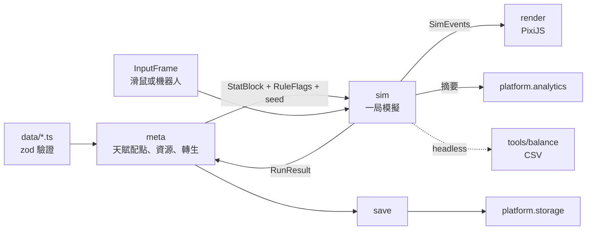

# 架構文件

> 狀態：草稿 v0.1（2026-10-12），等 Hoshi 確認。

## 1. 技術選型

| 項目 | 選擇 | 備註 |
| --- | --- | --- |
| 語言 | TypeScript（`strict` ＋ `noUncheckedIndexedAccess`） | |
| 打包 | Vite | 網頁版與 Electron renderer 共用 |
| 渲染 | PixiJS v8 | 幾何圖形、粒子、BitmapText 傷害數字 |
| 選單／HUD | DOM 疊在 canvas 上，先不用框架 | 文字清晰、i18n 容易；UI 變複雜再評估 Preact |
| 資料驗證 | zod | 載入時與測試時驗證資料檔與存檔 |
| 測試 | Vitest | 模擬核心、資料驗證、存檔遷移 |
| 程式風格 | ESLint（flat config）＋ Prettier | |
| CLI 執行 | tsx ＋ Node `worker_threads` | 平衡模擬器平行跑 |
| Steam 版 | Electron ＋ steamworks.js | M2 技術驗證 |
| 套件管理 | npm | 單一 package，不用 monorepo |

全部免費、不需要伺服器。唯一雲端服務是 Firebase 免費方案（Spark，沒有綁信用卡，額度用完只會寫入失敗，不會被收費）。

## 2. 目錄結構

```
src/
  core/        Num、數字格式化、seeded RNG、數學工具（純 TS）
  data/        天賦、敵人、波次、昇華的資料檔與 zod schema（純 TS）
  sim/         一局的模擬：狀態、系統、固定 timestep（純 TS）
  meta/        局外進度：資源、天賦配點、轉生、昇華（純 TS）
  save/        存檔序列化、版本遷移（純 TS）
  platform/    平台介面與各平台實作（web、steam、portal）
  render/      PixiJS：實體外觀、粒子、傷害數字、鏡頭、展示模式
  ui/          DOM：主選單、結算、天賦網外框、設定、HUD
  i18n/        en.json、zh-TW.json、型別化的 key
  app/         啟動、場景切換、遊戲主迴圈、平台注入
tools/
  balance/     平衡模擬器 CLI 與 build 策略
  talent-viewer/  開發用天賦網檢視器（Vite dev 頁面）
electron/      main process、preload、steamworks 橋接
tests/         跨模組測試、存檔 fixture
```

**純度邊界**：`core`、`data`、`sim`、`meta`、`save` 用獨立的 `tsconfig.sim.json` 編譯，`lib` 不含 DOM，所以碰到 `window`、`document` 會直接型別錯誤。ESLint 再加 `no-restricted-imports`（禁止 import `pixi.js`、`src/render`、`src/ui`、`src/platform`）與 `no-restricted-properties`（禁止 `Math.random`、`Date.now`、`performance.now`）。

## 3. 資料流



- `meta` 把天賦網與昇華編譯成一個 `StatBlock`（所有屬性的最終值）和一組 `RuleFlags`（keystone 開關與參數），交給 `sim` 開一局。
- `sim` 每個 tick 產出 `SimEvents`（擊中、暴擊、點燃、連鎖、死亡、掉落）。`render` 只讀狀態和事件，不改狀態。
- 一局結束時 `sim` 回傳 `RunResult`（最遠波次、各類傷害統計、掉落），`meta` 結算資源後存檔。
- 平衡模擬器直接呼叫 `meta` 與 `sim`，不載入 `render`、`ui`、`platform`。

## 4. 模擬核心

### 4.1 固定 timestep

- 固定 60 tick／秒（`dt = 1/60`）。瀏覽器用累加器迴圈，畫面以兩個 tick 之間插值。
- 遊戲加速（2x）就是每個畫面多跑幾個 tick，不改 `dt`。
- headless 時不等待，直接連續跑 tick。

### 4.2 可決定性

- 保證範圍：**同一個 build、同一個 seed、同一串 `InputFrame`，結果一致**。不保證跨版本或跨 JS 引擎，所以不做重播檔。
- RNG：自寫的 sfc32（約 20 行），每個子系統一條獨立的 stream（`spawn`、`combat`、`drops`），由主 seed 衍生。改掉落邏輯不會讓生怪順序跟著變，調數值時比較曲線才有意義。
- 實體用遞增整數 ID；只迭代陣列與 `Map`（插入順序固定），不依賴物件 key 的列舉順序。

### 4.3 狀態與系統

- 不用 ECS 框架。實體是物件陣列＋物件池（避免 GC 抖動），敵人用空間雜湊格查詢附近目標（連鎖、範圍傷害需要）。
- 每個 tick 依序跑系統：`input → spawn → movement → attack → projectiles → chain → ailments → death/drops → waveControl → runEnd`。

### 4.4 屬性與修正

```ts
type Modifier = {
  stat: StatId;                         // 'damage' | 'critChance' | 'chainCount' | ...
  kind: 'flat' | 'increased' | 'more';
  value: number;
  tags?: DamageTag[];                   // 'hit' | 'crit' | 'burn' | 'chain'
};
```

- 最終值 = `(base + Σflat) × (1 + Σincreased) × Π(1 + more)`，依標籤分別計算。
- **keystone 不寫成腳本**：每個 keystone 對應一個在程式裡列舉的 `RuleId` 加上型別化參數（例：`{ rule: 'critsAlwaysIgnite' }`）。資料檔只能引用已存在的規則，zod 會擋掉打錯字的 ID。

### 4.5 操作模式與輸入

```ts
type InputFrame = { cursor: Vec2 | null; activate: boolean };
type ControlMode = 'auto' | 'cursorZone' | 'activeSkill';
```

- 模式是 `sim` 的設定，三種模式共用所有系統，只有「攻擊來源」系統不同。
- 平衡模擬器的機器人策略：`cursorZone` 游標追最密集的敵群（空間雜湊格裡敵人最多的格子），`activeSkill` 冷卻好就對最密集處施放。

## 5. 大數字

- 設計天花板 ≤ 1e300，所以 `Num` 是加上品牌的 `number`：`type Num = number & { readonly __num: unique symbol }`。
- 所有大數的建立、運算、比較、序列化、格式化都走 `src/core/num.ts`。換成 break_eternity.js 時只改這個模組與用到原生運算子的地方。這是有意識的取捨：換實作會需要重構，但 1e300 的上限讓這件事大概不會發生。
- 開發 build 與平衡模擬器會檢查 `Infinity`／`NaN`，一出現就報錯並印出當下 build。
- 格式化可設定：
  - `short`：1.23K、4.56M、7.89B，1e15 以上改科學記號
  - `scientific`：1.23e15
  - `engineering`：123.4e12
  - `cjk`：1.2萬、3.4億、5.6兆（繁中預設）

## 6. 資料檔

- 每類資料一個 TS 檔，用 `satisfies` 拿到編輯器型別提示，載入時再過 zod schema。
- 天賦節點：`{ id, kind: 'small'|'notable'|'keystone', pos: {x, y}, links: id[], cost, modifiers?, rule?, nameKey, descKey }`。
- 驗證（Vitest 裡也跑一次）：ID 唯一、連線雙向、從起點全部可達、keystone 數量在範圍內、每個 i18n key 在 en 與 zh-TW 都存在。
- `tools/talent-viewer`：開發用頁面，畫出天賦網並標示錯誤，存檔後熱更新。不做拖拉編輯。

## 7. 平台抽象層

```ts
interface Platform {
  readonly id: 'web' | 'steam' | 'crazygames' | 'poki';
  storage: SaveStorage;        // read(slot) / write(slot, data) / list()
  achievements: Achievements;  // unlock(id) / isUnlocked(id)
  analytics: Analytics;        // track(event) / flush() / exportLocal()
  ads: Ads;                    // showRewarded() / showInterstitial()，非 portal 為 no-op
}
```

| 平台 | storage | achievements | analytics | ads |
| --- | --- | --- | --- | --- |
| web（itch.io、試玩） | localStorage | 本機記錄＋提示 | Firebase＋本機 | no-op |
| steam（Electron） | 檔案（透過 preload IPC） | steamworks.js | 本機（上市版預設不送雲端） | no-op |
| crazygames／poki | 平台 SDK 存檔 | 本機 | 平台 SDK | 平台 SDK |

- 用 Vite 的 `mode` 在建置時選平台（`vite build --mode steam`），其他平台的實作會被 tree-shake 掉。
- portal 實作在有需要時才寫（不在 MVP 必做）。

## 8. 存檔格式

```json
{ "v": 3, "savedAt": "2026-11-01T12:00:00Z", "game": "bc-incremental", "data": { } }
```

- JSON，不壓縮、不加密（單機遊戲，改存檔不是問題）。
- 讀檔流程：解析 → 依 `v` 依序跑 `migrations[v]` 直到最新版 → zod 驗證 → 載入。驗證失敗就載入備份並記錄錯誤。
- 兩個輪替槽位（`main`、`backup`），每局結束與選單中每 30 秒自動存檔。
- 設定頁提供匯出／匯入存檔字串（Base64），方便玩家回報問題。
- 每個舊版本保留一份 fixture 存檔，測試確保它能遷移到最新版並通過驗證。
- Steam 雲端存檔用 Steamworks 的 Auto-Cloud 同步存檔資料夾，不需要額外程式碼。

## 9. 試玩數據

- 匿名安裝 ID（隨機 UUID，存在本機），不收任何個資。
- 事件：`session_start`、`run_end`（波次、時長、操作模式、各流派投入點數、最高傷害）、`talent_allocate`、`prestige`、`session_end`（最後停留的畫面 = 退出點）。
- 本機先緩衝，每 5 分鐘、結算畫面和關閉頁面時批次寫入 Firestore（一個 session 一份文件），減少寫入次數。
- 免費額度是每天 2 萬次寫入。M1 試玩量很小沒問題；Next Fest 可能有每天數千名玩家，M3 前要重新估算，必要時改成抽樣或只在 session 結束寫一次。
- Firestore 安全規則：只允許新增、限制文件大小、不允許讀取。
- 設定頁有「匯出試玩數據」按鈕當備案；隱私說明寫在設定頁與 itch.io 頁面。

## 10. 渲染與展示模式

- 敵人與角色都是 `Graphics` 幾何形狀；粒子用 `ParticleContainer`；傷害數字用物件池的 `BitmapText`，字級依 `log10(傷害)` 放大。
- 手感工具：hit-stop、畫面震動、擊中閃白，強度都隨數值量級調整，設定頁可以關掉震動。
- 展示模式（M2）：隱藏 UI、固定 seed、載入預設 build、腳本化鏡頭，給截圖與預告片錄影用。
- 畫面縮放：邏輯解析度固定 1920×1080，等比縮放；UI 字級可以在設定中調整。

## 11. Electron 與 Steam（M2 技術驗證）

- `contextIsolation: true`，preload 只暴露最小 API（`storage`、`achievements`、`steamInfo`）。
- steamworks.js 在 main process 初始化；技術驗證先用測試 App ID 480（Spacewar），不必等 Steam 上架費。
- Steam overlay 需要 steamworks.js 的 `electronEnableSteamOverlay()` 加上 Chromium 參數，這是 M2 最大的技術風險，第一週先驗證。

## 12. 平衡模擬器

```
npm run balance -- --strategy crit-greedy --mode auto --runs 2000 --seed 1 --out out/crit
```

- **策略** = 配點策略（依優先順序貪婪購買，例：`crit-greedy`、`dot-greedy`、`chain-greedy`、`hybrid-crit-dot`）＋ 操作機器人（第 4.5 節）＋ 何時轉生。
- 模擬完整進度：開局 → 結算 → 配點 → 下一局 → 轉生 …，直到時間上限或目標波次。局間停留時間是可設定的假設值（預設 20 秒），用來換算玩家實際遊玩時間。
- 輸出 CSV：
  - `runs.csv`：每局一列（累計時間、局數、最遠波次、各類 DPS、資源收入、已點節點數）
  - `milestones.csv`：到達第 N 波、第一個 keystone、第一次轉生的累計時間
  - `dps_probe.csv`：固定 build 對木樁的 DPS 曲線
- `worker_threads` 平行跑；M0 先量效能，目標一局 3 分鐘的模擬在 100 ms 內跑完。

## 13. i18n

- `en.json` 是 key 的來源，`zh-TW.json` 由測試檢查是否缺漏；key 的型別從 `en.json` 產生，打錯 key 會編譯失敗。
- 插值用 `{name}` 語法，數字一律先經過 `num.ts` 格式化。
- 中文字型用 Noto Sans TC（OFL 授權），建置時依實際用到的字做子集化（M3）。

## 14. CI 與發布

- GitHub Actions：`lint` → `typecheck` → `test` → `build:web`，build 結果存成 artifact。
- 試玩版發布到 itch.io（免費，可以設成限制存取的頁面），M1 加上用 butler 從 CI 上傳。
- Steam 版在本機用 `npm run build:steam` 產出，用 SteamPipe 上傳（M3）。
