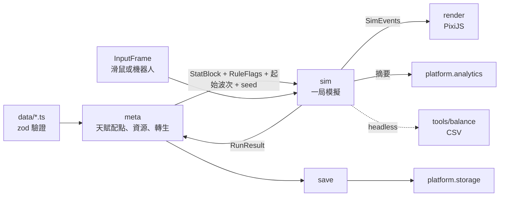

# 架構文件

> 狀態：草稿 v0.2（2026-10-12），依 Hoshi 第一輪審查修改。

## 1. 技術選型

| 項目 | 選擇 | 備註 |
| --- | --- | --- |
| 語言 | TypeScript（`strict` ＋ `noUncheckedIndexedAccess`） | |
| 打包 | Vite | 網頁版與 Electron renderer 共用 |
| 渲染 | PixiJS v8 | 幾何圖形、粒子、BitmapText 傷害數字 |
| 選單／HUD | DOM 疊在 canvas 上，先不用框架 | 文字清晰、i18n 容易；UI 變複雜再評估 Preact |
| 資料驗證 | zod | 載入時與測試時驗證資料檔與存檔 |
| 測試 | Vitest | 模擬核心、資料驗證、存檔遷移 |
| 程式風格 | ESLint（flat config）＋ Prettier | |
| CLI 執行 | tsx ＋ Node `worker_threads` | 平衡模擬器平行跑 |
| Steam 版 | Electron ＋ steamworks.js | M2 技術驗證 |
| 套件管理 | npm | 單一 package，不用 monorepo |

全部免費、不需要伺服器。唯一雲端服務是 Firebase 免費方案（Spark，沒有綁信用卡，額度用完只會寫入失敗，不會被收費）。

## 2. 目錄結構

```
src/
  core/        Num、數字格式化、seeded RNG、數學工具（純 TS）
  data/        天賦、敵人、波次、昇華的資料檔與 zod schema（純 TS）
  sim/         一局的模擬：狀態、系統、固定 timestep（純 TS）
  meta/        局外進度：資源、天賦配點、轉生、昇華（純 TS）
  save/        存檔序列化、版本遷移（純 TS）
  platform/    平台介面與各平台實作（web、steam、portal）
  render/      PixiJS：實體外觀、粒子、傷害數字、鏡頭、展示模式
  ui/          DOM：主選單、結算、天賦網外框、設定、HUD
  i18n/        en.json、zh-TW.json、型別化的 key
  app/         啟動、場景切換、遊戲主迴圈、平台注入
tools/
  balance/     平衡模擬器 CLI 與 build 策略
  talent-viewer/  開發用天賦網檢視器（Vite dev 頁面）
electron/      main process、preload、steamworks 橋接
tests/         跨模組測試、存檔 fixture
```

**純度邊界**：`core`、`data`、`sim`、`meta`、`save` 用獨立的 `tsconfig.sim.json` 編譯，`lib` 不含 DOM，所以碰到 `window`、`document` 會直接型別錯誤。ESLint 再加 `no-restricted-imports`（禁止 import `pixi.js`、`src/render`、`src/ui`、`src/platform`、`src/app` 與 Node 內建模組，資料夾本身與裡面的檔案都擋）、`no-restricted-properties`（禁止 `Math.random`、`Date.now`、`performance.now`）與 `no-restricted-syntax`（禁止動態 `import()`、讀取現在時間的 `new Date()`）。`tsc` 有 `skipLibCheck`，擋不住 `pixi.js` 這類套件，所以 `tests/purity-lint.test.ts` 用探針原始碼確認這些規則一直有效。

## 3. 資料流



- `meta` 把天賦網與昇華編譯成一個 `StatBlock`（所有屬性的最終值）和一組 `RuleFlags`（keystone 開關與參數），連同起始波次交給 `sim` 開一局。跳波補償由 `meta` 在結算時依期望掉落計算，`sim` 只回報有沒有清掉起始波次。
- `sim` 每個 tick 產出 `SimEvents`（擊中、暴擊、點燃、連鎖、死亡、掉落）。`render` 只讀狀態和事件，不改狀態。
- 一局結束時 `sim` 回傳 `RunResult`（最遠波次、各類傷害統計、掉落），`meta` 結算資源後存檔。
- 平衡模擬器直接呼叫 `meta` 與 `sim`，不載入 `render`、`ui`、`platform`。

## 4. 模擬核心

### 4.1 固定 timestep

- 固定 60 tick／秒（`dt = 1/60`）。瀏覽器用累加器迴圈，畫面以兩個 tick 之間插值。
- 遊戲加速（2x）就是每個畫面多跑幾個 tick，不改 `dt`。
- headless 時不等待，直接連續跑 tick。

### 4.2 可決定性

- 保證範圍：**同一個 build、同一個 seed、同一串 `InputFrame`，結果一致**。不保證跨版本或跨 JS 引擎，所以不做重播檔。
- RNG：自寫的 sfc32（約 20 行），每個子系統一條獨立的 stream（`spawn`、`split`、`combat`、`drops`），由主 seed 衍生。改掉落邏輯不會讓生怪順序跟著變，調數值時比較曲線才有意義。分裂子怪的位置走 `split`：分裂的次數與時機取決於戰鬥，如果共用 `spawn`，改傷害就會讓後面每一波的生怪跟著變。
- 實體用遞增整數 ID；只迭代陣列與 `Map`（插入順序固定），不依賴物件 key 的列舉順序。

### 4.3 狀態與系統

- 不用 ECS 框架。實體是物件陣列＋物件池（避免 GC 抖動），敵人用空間雜湊格查詢附近目標（連鎖、範圍傷害需要）。
- 每個 tick 依序跑系統：`input → spawn → movement → attack → projectiles → chain → ailments → death/drops → waveControl → runEnd`。

### 4.4 屬性與修正

```ts
type Modifier = {
  stat: StatId;                         // 'damage' | 'critChance' | 'chainCount' | ...
  kind: 'flat' | 'increased' | 'more';
  value: number;
  tags?: DamageTag[];                   // 'hit' | 'crit' | 'burn' | 'chain'
};
```

- 最終值 = `(base + Σflat) × (1 + Σincreased) × Π(1 + more)`，依標籤分別計算。
- **keystone 不寫成腳本**：每個 keystone 對應一個在程式裡列舉的 `RuleId` 加上型別化參數（例：`{ rule: 'critsAlwaysIgnite' }`）。資料檔只能引用已存在的規則，zod 會擋掉打錯字的 ID。

### 4.5 輸入

```ts
type InputFrame = { cursor: Vec2 | null; activate: boolean };
type ControlMode = 'auto';
```

- 操作模式定為全自動（GDD 2.3），`sim` 目前不讀 `InputFrame`。介面保留，之後如果要加局中操作，不必改模擬核心的呼叫方式。

## 5. 大數字

- 設計天花板 ≤ 1e300，所以 `Num` 是加上品牌的 `number`：`type Num = number & { readonly __num: unique symbol }`。
- 所有大數的建立、運算、比較、序列化都走 `src/core/num.ts`，格式化在 `src/core/format.ts`（只透過 `toNumber()` 讀值）。換成 break_eternity.js 時只改這個模組與用到原生運算子的地方。這是有意識的取捨：換實作會需要重構，但 1e300 的上限讓這件事大概不會發生。
- 開發 build 與平衡模擬器會檢查 `Infinity`／`NaN`，一出現就報錯並印出當下 build。
- 格式化可設定：
  - `short`：1.23K、4.56M、7.89B，1e15 以上改科學記號
  - `scientific`：1.23e15
  - `engineering`：123.4e12
  - `cjk`：1.2萬、3.4億、5.6兆（繁中預設）

## 6. 資料檔

- 每類資料一個 TS 檔，用 `satisfies` 拿到編輯器型別提示，載入時再過 zod schema。
- 天賦節點：`{ id, kind: 'small'|'notable'|'keystone', pos: {x, y}, links: id[], cost, modifiers?, rule?, nameKey, descKey }`。
- 驗證（Vitest 裡也跑一次）：ID 唯一、連線雙向、從起點全部可達、keystone 數量在範圍內、每個 i18n key 在 en 與 zh-TW 都存在。
- `tools/talent-viewer`：開發用頁面，畫出天賦網並標示錯誤，存檔後熱更新。不做拖拉編輯。

## 7. 平台抽象層

```ts
interface Platform {
  readonly id: 'web' | 'steam' | 'crazygames' | 'poki';
  storage: SaveStorage;        // read(slot) / write(slot, data) / list()
  achievements: Achievements;  // unlock(id) / isUnlocked(id)
  analytics: Analytics;        // track(event) / flush() / exportLocal()
  ads: Ads;                    // showRewarded() / showInterstitial()，非 portal 為 no-op
}
```

| 平台 | storage | achievements | analytics | ads |
| --- | --- | --- | --- | --- |
| web（itch.io、試玩） | localStorage | 本機記錄＋提示 | Firebase＋本機 | no-op |
| steam demo（Electron） | 檔案（透過 preload IPC） | steamworks.js | Firebase＋本機（預設開，可在設定關閉） | no-op |
| steam 正式版（Electron） | 檔案（透過 preload IPC） | steamworks.js | 本機（送雲端預設關閉，可在設定開啟） | no-op |
| crazygames／poki | 平台 SDK 存檔 | 本機 | 平台 SDK | 平台 SDK |

- 用 Vite 的 `mode` 在建置時選平台（`vite build --mode steam`），其他平台的實作會被 tree-shake 掉。
- 另一個建置參數 `VITE_FLAVOR=demo|full` 決定 demo 或正式版：demo 內容上限、analytics 預設值、結束畫面的願望清單按鈕都看它。
- portal 實作在有需要時才寫（不在 MVP 必做）。

## 8. 存檔格式

```json
{ "v": 3, "savedAt": "2026-11-01T12:00:00Z", "game": "bc-incremental", "data": { } }
```

- JSON，不壓縮、不加密（單機遊戲，改存檔不是問題）。
- 讀檔流程：解析 → 依 `v` 依序跑 `migrations[v]` 直到最新版 → zod 驗證 → 載入。驗證失敗就載入備份並記錄錯誤。
- 兩個輪替槽位（`main`、`backup`），每局結束與選單中每 30 秒自動存檔。
- 設定頁提供匯出／匯入存檔字串（Base64），方便玩家回報問題。
- 每個舊版本保留一份 fixture 存檔，測試確保它能遷移到最新版並通過驗證。
- Steam 雲端存檔用 Steamworks 的 Auto-Cloud 同步存檔資料夾，不需要額外程式碼。

## 9. 試玩數據

- 匿名安裝 ID（隨機 UUID，存在本機），不收任何個資。
- 事件：`session_start`、`run_end`（起始波次、最遠波次、時長、各流派投入點數、keystone、最高傷害）、`talent_allocate`、`respec`、`prestige`、`session_end`（最後停留的畫面 = 退出點）。
- M1 閘門看每位玩家的總遊玩時間中位數（GDD 2.3：只有模式 A）。
- 本機先緩衝，再批次寫入 Firestore（一個 session 一份文件），減少寫入次數：
  - 網頁試玩版：每 5 分鐘、結算畫面、關閉頁面時寫入。
  - Steam demo：每 10 分鐘與關閉遊戲時寫入（Electron main process 可以在結束前確實送出）。
- 各 build 的預設值：

| build | 送雲端 | 說明位置 |
| --- | --- | --- |
| 網頁試玩版（itch.io） | 預設開，可關閉 | 設定頁、itch.io 頁面 |
| Steam demo | 預設開，可關閉 | 設定頁、商店頁 demo 說明 |
| Steam 正式版 | 預設關，可開啟 | 設定頁 |

- 免費額度是每天 2 萬次寫入，超過只會寫入失敗、不會收費。估算公式：`每日寫入 ≈ 每日玩家數 × 每人 session 數 × 每 session 寫入次數`。例：Next Fest 每天 5,000 名玩家 × 1.2 session × 約 4 次 = 2.4 萬，會超過。M3 要依實際 demo 的 session 長度重算，必要時改成抽樣（例如只送一半的安裝 ID）或拉長寫入間隔。這項列在 `MILESTONES.md` M3。
- Firestore 安全規則：只允許新增、限制文件大小、不允許讀取。
- 設定頁有「匯出試玩數據」按鈕當備案。

## 10. 渲染與展示模式

- 敵人與角色都是 `Graphics` 幾何形狀；粒子用 `ParticleContainer`；傷害數字用物件池的 `BitmapText`。
- `render` 只讀 `SimState` 與 `SimEvents`；所有特效用畫面時間（wall-clock）計時，不跟模擬 tick 走，所以加速與 hit-stop 不會讓特效跟著快轉或凍結。單一畫面的特效時間上限 100 ms，切分頁回來不會一口氣播完。
- 原則：**擠的畫面少畫細節，不掉幀**。每個特效池都有硬上限，超過就丟掉新的（或換掉最舊的），不會讓畫面變慢。
- 展示模式（M2）：隱藏 UI、固定 seed、載入預設 build、腳本化鏡頭，給截圖與預告片錄影用。
- 畫面縮放：邏輯解析度固定 1920×1080（arena 單位），等比縮放加黑邊；UI 字級可以在設定中調整。

### 10.1 圖層（由下往上）

| 圖層 | 內容 | 上限 |
| --- | --- | --- |
| 背景 | 格線、地面光、暗角，快取成一張貼圖 | — |
| 燃燒光暈（add） | 每隻燃燒中的敵人一個深橘色光暈，隨層數放大 | 跟著燃燒中的敵人數 |
| 敵人火焰（add） | 燃燒中的敵人冒出的火舌、瘟疫餘燼落地的火團，畫在怪群**下面** | 火舌 520、火團光暈 110；全場每秒最多 650 個新火舌，超過時每隻敵人按比例少噴 |
| 敵人 | 每隻一個 `Graphics`：暗色底＋半透明填色＋實心外框，用 tint 上色；菁英與 Boss 在小怪下面 | 每種敵人一個物件池 |
| 環（add） | 擊殺衝擊波、瘟疫火環 | 衝擊波 40；完整火環 3，再多只畫外圈（10） |
| 角色、投射物 | | — |
| 連鎖閃電（add） | 鋸齒狀青色閃電，白色核心，每 42 ms 重抖一次，壽命 180 ms | 80 條，滿了換掉最舊的 |
| 特效粒子（add） | 擊殺碎片、火花、閃光、瘟疫擴散的火焰與餘燼 | 碎片 420、火花 360、閃光 110、火焰 520、餘燼 64 |
| 掉落碎片 | 飛向角色的碎片 | — |
| 傷害數字 | 一般數字池在下，大暴擊池在最上層 | 見 10.2 |

畫布之上是 DOM 的 HUD（`src/ui`）。燃燒的敵人：火焰與光暈在下、敵人的外框與原本的顏色在上（燃燒只讓 tint 偏橘 6–20%），暗色底讓形狀在亮的特效上仍是清楚的剪影；火焰的強度在 4 層封頂（`eternalFlame` 沒有層數上限，畫面不跟著無限放大）。同一個畫面死掉的敵人越多，每一隻的白色爆心越暗、碎片越少，怪群一起死時不會變成一團白光。瘟疫火環的火舌從同一點出發會疊加，所以用半透明的橘色起頭，火環中心不會是一片白。

### 10.2 傷害數字

- **字級**：依「這筆傷害 ÷ 本局一般擊中」的 `log10` 放大（本局一般擊中 = 基礎傷害 × 擊中類傷害倍率，由 `src/app/session.ts` 傳進來），每種數字都有低上限（arena 單位，一般擊中的基準是 22）：

| 數字 | 基準字高 | 每 10 倍 | 上限 |
| --- | --- | --- | --- |
| 一般擊中 | 22 | +30% | 約 29（1.3 倍） |
| 連鎖 | 20 | +30% | 約 26 |
| 燃燒 | 16 | +25% | 22 |
| 大暴擊（發光字型、彈出） | 30 | +12% | 約 35（1.6 倍；彈出最高點 ×1.12，約 1.8 倍） |
| 小暴擊（一般字型、暴擊黃） | 24 | +10% | 約 28 |

- **大暴擊的預算**：同時最多 6 個大暴擊彈出；超過的暴擊改用一般大小、暴擊顏色的小暴擊。暴擊閃光也跟著分級：大暴擊有星芒、光暈、衝擊環，小暴擊只有小星芒與火花；閃光大小在超過一般擊中 10^1.5 倍後不再變大。
- **上限**：一般數字池 80 個，其中一般擊中 40、連鎖 30、燃燒 30、小暴擊 18；超過就不顯示新的。
- **合併**：同一隻敵人、同一種數字，在 220 ms 內的新傷害加到原本的數字上（數字跳一下），不再疊出「84.384.3」。燃燒另外先在 `BurnTally` 依敵人累計 380 ms 才顯示一次，敵人死亡時立刻顯示。
- **錯開**：新數字先試原位，再試上方、下方、上方兩格、左右各一格，找不到不會蓋住其他數字的位置就不顯示（暴擊也一樣，閃光照放）。上下相鄰的數字最多重疊 5%（只有外框碰到）；左右相鄰的數字之間一定要留約字高五分之一的空隙，不然兩個數字會黏成一個（「84.384.3」）。
- **壽命**：一般擊中與連鎖 650 ms、燃燒 600 ms、大暴擊 760 ms、小暴擊 560 ms；數字池越滿，新數字的壽命越短，滿載時少 45%。
- **避開 HUD**：HUD 的範圍以螢幕像素定義（對照 `src/ui/style.ts`：左上波次區 280×136、上方 84 高的生命條與資源列、右下 240×92 的速度按鈕），每次縮放時換算成 arena 單位。數字整段上飄的路徑都不能進入這些區域：靠上緣的往下推、右下角的往上推，左右不超出 arena。
- 實作：`src/render/damageNumbers.ts`（物件池與動畫）、`src/render/numberLayout.ts`（字級、壽命、HUD 區域、錯開，純函式，有測試）。

### 10.3 畫面震動與 hit-stop 的預算

- **畫面震動**（`src/render/shake.ts`）：trauma 模型，位移 = 14 × trauma²（arena 單位），每秒衰減 3.2。每次震動指定一個天花板，小的震動不能把 trauma 推過它：
  - 暴擊：至少是一般擊中的 2 倍才震，0.24 + 每 10 倍 0.2，天花板 0.55，兩次之間至少 300 ms。
  - 菁英擊殺 0.55（天花板 0.75）；Boss 擊殺 1.0。
- **hit-stop**（`src/app/loop.ts` 的 `HitStop`）：停頓期間模擬時間只走 10%，特效照常播放。單次最長 80 ms（重疊的請求取長的、不疊加），少於 15 ms 不理；停完 200 ms 內不接受新的（除非比剛結束的那次長）；總量有預算：存量 160 ms，每 1 ms 畫面時間回補 0.08 ms，所以不管請求多頻繁，停頓不會超過遊玩時間的 8%。
- **誰會請求 hit-stop**：
  - 菁英擊殺 55 ms、Boss 擊殺 80 ms。
  - 暴擊（`src/render/critStop.ts`）：要同時符合三個條件——至少是一般擊中的 20 倍；至少是本局「平常暴擊」的 2 倍（平常暴擊是對數空間的移動平均，每次暴擊權重 0.25，開局從一般擊中算起）；距離上次暴擊 hit-stop 至少 2.5 秒。長度 30 ms，每多 10 倍加 30 ms，最多 60 ms。
- **為什麼這麼少**：GDD §3.2 原本寫「暴擊帶短暫 hit-stop」（已改成和這裡一致）。冷靜狙擊每第 3 次攻擊整波必定暴擊，試玩用的暴擊 build（冷靜狙擊＋刺客等）每發暴擊約是一般擊中的 25 倍，原本的門檻（約 4 倍、冷卻 0.7 秒）讓每波暴擊都停一下，任何速度下每 0.7 秒卡一次。現在暴擊 hit-stop 是稀有的強調：同一局的暴擊大小幾乎固定，實際上只有開局第一個夠大的暴擊會停一下，之後只有遠大於平常的暴擊才會；暴擊的手感改由數字彈出、閃光與震動負責。
- 減少動態（`reducedMotion`）會同時關掉震動與 hit-stop；目前是 `src/app/main.ts` 的常數，設定頁之後再接。

## 11. Electron 與 Steam（M2 技術驗證）

- `contextIsolation: true`，preload 只暴露最小 API（`storage`、`achievements`、`steamInfo`）。
- steamworks.js 在 main process 初始化；技術驗證先用測試 App ID 480（Spacewar），不必等 Steam 上架費。
- Steam overlay 需要 steamworks.js 的 `electronEnableSteamOverlay()` 加上 Chromium 參數，這是 M2 最大的技術風險，第一週先驗證。

## 12. 平衡模擬器

```
npm run balance -- --strategy crit-greedy --sessions 20 --minutes 60 --seed 1 --out out/crit
```

- **策略** = 配點策略（依優先順序貪婪購買，例：`crit-greedy`、`dot-greedy`、`chain-greedy`、`hybrid-crit-dot`）＋ 起始波次策略 ＋ 何時轉生。
- 起始波次策略（`--start-wave`）：`max`（預設，每局選允許的最高波次）、`ratio:<x>`（選最遠波次的 x 倍）、`1`（永遠從頭打，用來和跳波比較收入）。`startWaveRatio`、`skipRewardRate` 也可以用參數覆寫。
- 模擬完整進度：開局 → 結算 → 配點 → 下一局 → 轉生 …，直到時間上限或目標波次。局間停留時間是可設定的假設值（預設 20 秒），用來換算玩家實際遊玩時間。
- 輸出 CSV：
  - `runs.csv`：每局一列（累計時間、局數、起始波次、最遠波次、該波標準怪血量、有效單發傷害 `D`、前線擊殺次數、溢傷 10 倍以上波次的時間比例、各類 DPS、資源收入（含跳波補償）、已點節點數）
  - `milestones.csv`：到達第 N 波、第一個 keystone、第一次轉生的累計時間
  - `curve_check.csv`：每個驗收時間點的實際值與 GDD 第 7 節主曲線目標並列，標出超出容許範圍的列
  - `dps_probe.csv`：固定 build 對木樁的 DPS 曲線
- 驗收標準就是 GDD 第 7.5 節；主曲線（血量分段、擊殺次數倍率）放在 `src/data/curve.ts`，遊戲與模擬器共用同一份。
- `worker_threads` 平行跑；M0 先量效能，目標一局 3 分鐘的模擬在 100 ms 內跑完。

## 13. i18n

- `en.json` 是 key 的來源，`zh-TW.json` 由測試檢查是否缺漏；key 的型別從 `en.json` 產生，打錯 key 會編譯失敗。
- 插值用 `{name}` 語法，數字一律先經過 `num.ts` 格式化。
- 語系依瀏覽器語言選擇（繁中標籤 `zh-TW`、`zh-Hant`、`zh-HK`、`zh-MO` 用 `zh-TW`，其他用英文）；網址加 `?lang=zh-TW` 或 `?lang=en` 可以直接切換，方便測試。
- 天賦名稱走 `nameKey`；`descKey` 目前沒有畫面用到，M1 做天賦網 UI 時再補文字與檢查。
- 中文字型用 Noto Sans TC（OFL 授權），建置時依實際用到的字做子集化（M3）。

## 14. CI 與發布

- GitHub Actions：`lint` → `typecheck` → `test` → `build:web`，build 結果存成 artifact。
- 試玩版發布到 itch.io（免費，可以設成限制存取的頁面），M1 加上用 butler 從 CI 上傳。
- Steam 版在本機用 `npm run build:steam` 產出，用 SteamPipe 上傳（M3）。
