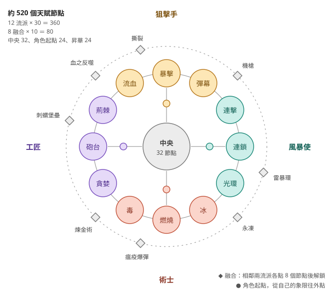

# 遊戲設計 v2：4 角色、12 流派、8 融合、約 520 節點

> 2026-10-13 · 回應 Hoshi：「按照這個流派與玩法整理，重新思考這個遊戲應該怎麼實現」
> 實作方式、時程與給實作專案的指示在 [implementation-plan-v2.md](implementation-plan-v2.md)。
> 所有數值都是**初始值**，交給平衡模擬器調整；遊玩時間是推論，信心低。
>
> **和先前設計稿的關係**：這份取代選題專案先前三份設計稿（流派目錄 v1、天賦網 v1、內容規劃 v1）裡的融合清單、角色、節點規模與敵人表。那三份不在 repo 裡；仍然沿用的規則（節點買法、七種節點效果、回饋特效、死亡回顧、敵人細節）整理在**附錄 A**。

---

## 0. 結論先講

1. **骨架是「4 個角色 × 每個角色 3 種流派」。** 天賦網是一個環：12 個流派排成一圈，每個角色從自己的象限出發；相鄰兩個流派之間有 8 個融合流派。
2. **500 節點不是要人點滿，是讓 4 個角色各走出不同的路。** 一個角色一輪轉生點得到約 60–80 個節點，破關時約 120–150 個（約四分之一張網）。4 個角色都玩過，才會看過大部分的網。
3. **每種敵人考一個問題，12 個流派都要有自己的答案**（§5 對照表）。這是平衡模擬器的硬指標，也是「撞牆 → 看懂 → 改 build」循環的來源。
4. **遊戲有終點**：第 100 波的最終 Boss「奇點」＝破關，之後是無盡模式與挑戰。遊玩時間（推論）：第一個角色破關 4–6 小時，4 個角色 12–20 小時。
5. **Demo 只放狙擊手＋術士**（約 100 節點）；風暴使和工匠看得到但鎖住，標「完整版」。

---

## 1. 四個角色

| 角色 | 位置 | 三個流派 | 招牌攻擊（初始值） | 解鎖 | 昇華（2 選 1） |
|---|---|---|---|---|---|
| **狙擊手** | 上 | 流血、暴擊、彈幕 | **穿透箭**：投射物穿透 1 個敵人；基礎暴擊率 10%（其他角色 5%）；攻速 3／秒、傷害 13（其他角色 4／秒、10） | 一開始 | 處刑者／獵人 |
| **術士** | 下 | 冰、燃燒、毒 | **三相彈**：每次攻擊依序射出火、冰、毒彈，各帶 20% 點燃／冰冷／中毒機率 | 任一角色第一次轉生 | 焚化者／冰后 |
| **風暴使** | 右 | 連擊、連鎖、光環 | **跳躍閃電**：投射物 1 發，基礎連鎖 2 次並造成感電 | 任一角色到第 60 波 | 暴風眼／疾雷 |
| **工匠** | 左 | 貪婪、砲台、荊棘 | **工坊**：起始 1 座砲台、碎片 +10%；自己的攻擊傷害 −30% | 任一角色到第 80 波 | 機械師／富豪 |

- **角色不是換皮**：每個角色有自己的招牌攻擊、起點、天賦配置、轉生進度與昇華。
- **共用的是「傳承」**：任何角色達成里程碑，全帳號永久加成（§6），所以第二個角色會比第一個快。
- **解鎖時間點**（推論）：術士約 40 分鐘（第一次轉生時，剛好是玩家本來就要重來的時候）、風暴使約 2 小時、工匠約 3.5 小時。第一個角色的 4–6 小時裡，每隔一段時間就有新角色。
- 這取代先前提過的「3 個角色」方案。原本 GDD §6 的「風暴使」昇華變成角色，它的規則（連鎖分岔）改當風暴使的昇華「暴風眼」。

### 1.1 昇華（轉生後選一個，用迴響點；每個 3 個節點）

| 角色 | 昇華 A | 昇華 B |
|---|---|---|
| 狙擊手 | **處刑者**：暴擊命中生命 < 20% 的敵人直接處決；終極：處決時對周圍造成牠最大生命 10% 的傷害 | **獵人**：流血的敵人受到投射物傷害 +20%；終極：投射物命中流血的敵人時 +1 穿透 |
| 術士 | **焚化者**：燃燒擊殺時爆炸，打出剩餘燃燒傷害；終極：爆炸也會上毒 | **冰后**：冰凍時間 +50%；終極：碎裂會冰凍周圍敵人 |
| 風暴使 | **暴風眼**：每次連鎖分岔成 2 道；終極：感電上限 +3 層 | **疾雷**：連擊每層也給 +1% 暴擊率；終極：每累積 50 層，落雷打所有感電的敵人 |
| 工匠 | **機械師**：砲台 +2；終極：砲台也吃持有碎片加成 | **富豪**：利息上限翻倍；終極：寶藏怪必掉核心 |

---

## 2. 天賦網結構

環上的順序（順時針，從上方開始）：

| 象限 | 流派（順時針） | 象限內的融合 | 和下一個象限交界的融合 |
|---|---|---|---|
| 狙擊手（上） | 流血、暴擊、彈幕 | 撕裂（流血 × 暴擊） | 機槍（彈幕 × 連擊） |
| 風暴使（右） | 連擊、連鎖、光環 | 雷暴環（連鎖 × 光環） | 永凍（光環 × 冰） |
| 術士（下） | 冰、燃燒、毒 | 瘟疫爆彈（燃燒 × 毒） | 煉金術（毒 × 貪婪） |
| 工匠（左） | 貪婪、砲台、荊棘 | 刺蝟堡壘（砲台 × 荊棘） | 血之反噬（荊棘 × 流血） |

- **中央**：4 個角色的起點圍著中央，中央環連通所有流派入口。去別的象限要經過中央，路上的節點本身就有用（防禦、經濟、回響）。
- **流派區**：每個流派佔 30°，從內往外分成三個分支，每個分支中段分岔成兩條、末端會合（附錄 A.1）。
- **融合區**：在兩個相鄰流派交界的最外圈。**兩邊各點到 8 個節點才能點入口**。4 個融合在角色象限內，4 個在角色交界，所以每個角色都有 1 個自己的融合和 2 個跨角色融合。

### 2.1 節點預算

| 區塊 | 數量 | 每個 | 小計 | 組成 |
|---|---|---|---|---|
| 流派區 | 12 | 30 | 360 | 入口 1、三個分支各 9（6 等級＋2 顯著＋1 精通）、關鍵天賦 1、門檻節點 1 |
| 融合區 | 8 | 10 | 80 | 入口 1、融合核心 1、等級 6、顯著 1、精通 1 |
| 中央 | 1 | 32 | 32 | 樞紐、強化∞、防禦 8、經濟 6、回響 10、規則關鍵天賦 6 |
| 角色起點 | 4 | 6 | 24 | 起點 1、通往三個流派與中央的等級節點 5 |
| 昇華 | 8 | 3 | 24 | 2 顯著＋1 終極（在另一個面板，不在網上） |
| **合計** | | | **520** | |

依實作方式分：

| 類型 | 約數 | 怎麼做 |
|---|---|---|
| 等級節點（含精通、強化） | 365 | 用模板產生，只填屬性與數值 |
| 顯著節點 | 117 | 資料驅動：觸發、條件、轉換、縮放，**不用寫程式** |
| 規則模組 | 38 | 要寫程式：12 流派關鍵天賦、6 中央關鍵天賦、8 融合核心、8 昇華終極、4 角色招牌攻擊 |

有上限的等級節點約 320 個、平均 4 級，可購買約 1,300 級；另外有 44 個無限精通（每個分支末端 1 個、每個融合 1 個）和中央強化。

### 2.2 點數預算（為什麼還是要選）

- 一輪轉生約點 60–80 個節點；破關時約 120–150 個（推論，模擬器驗證）。
- 典型配置：主流派 25–30＋副流派 10–15＋1 個融合 10＋中央 15＋起點 6＋路徑節點。
- 關鍵天賦同時最多 2 個。融合核心和昇華不算在內。
- 免費洗點不變，這是撞牆後換 build 的成本保證。

### 2.3 門檻節點

每個流派區有 1 個門檻節點：**本區點滿 10 個節點後才能點**，效果一定是畫面上看得到的招牌強化（例如暴擊的「斬首線」）。這是純流派玩家的爆發點，也是預告片素材。

---

## 3. 十二個流派

格式：機制（初始值）→ 三個分支（◆＝顯著節點，標「答案」的是對付某種敵人的節點，對應 §5）→ ★ 關鍵天賦 → 門檻節點。

### 3.1 狙擊手象限

**流血**（新）
- 機制：擊中有機率流血，每秒 40% 擊中傷害、持續 4 秒；同一隻只算最強的一個。**移動中的敵人流血 ×3**，敵人一直往中央走，所以大部分時間都是 ×3。
- 撕裂：流血機率、流血傷害；◆ 深傷（流血 +2 秒）；◆ 割裂（流血無視護盾，被擋下的擊中仍會流血，答案：盾兵）
- 追獵：移動加成、對遠處敵人加傷；◆ 傷口撕裂（停下來的敵人流血 ×2，答案：射手、召喚者）；◆ 獵物標記（流血的敵人受到其他傷害 +15%）
- 放血：◆ 血爆（流血的敵人死時噴血霧，半徑 90 內的敵人流血）；◆ 抗凝（流血的敵人不能回血）
- ★ 大出血：流血最多疊 8 層，但失去移動 ×3。
- 門檻「血河」：流血的敵人在地上留下紅色軌跡，踩到的敵人也流血。

**暴擊**（M1 已有，擴充）
- 機制：暴擊率 × 暴擊倍率。
- 精準：暴擊率、對菁英與 Boss 暴擊率；◆ 鎖定（自動打血量最高的敵人）；◆ 專注（連續打同一目標，暴擊率遞增）
- 重擊：暴擊倍率、擊中傷害；◆ 處決（生命 < 30% 必定暴擊，答案：再生者）；◆ 破甲（暴擊無視堅甲）
- 暴擊觸發：◆ 碎裂暴擊（暴擊時在目標處爆炸，半徑 80、20% 傷害，答案：三角群）；◆ 熾烈暴擊（暴擊必定點燃，M1 的關鍵天賦降級）
- ★ 冷靜狙擊（M1 已有）
- 門檻「斬首線」：暴擊會畫出一道白色斬擊線，線上的敵人也受到傷害。

**彈幕**（多重投射，新）
- 機制：投射物數量、散射、彈射、分裂。每發都是一次小擊中。
- 齊射：投射物數量；◆ 扇形（多出的投射物改成扇形，可以打同一隻）；◆ 環射（每第 6 次攻擊朝 12 個方向射出）
- 彈射：穿透、彈射；◆ 跳彈（撞到場地邊緣反彈一次）；◆ 集火（0.2 秒內打中同一隻的多發合併計算護盾門檻，答案：盾兵）
- 分裂：◆ 子母彈（擊殺時分裂成 3 發）；◆ 聚焦（場上只剩 1 個目標時，所有投射物都打它，傷害 +20%，答案：Boss）
- ★ 子彈地獄：投射物數量 ×2，每發傷害 −40%，投射物會在場地邊緣反彈。
- 門檻「彈雨」：每 10 秒進入 2 秒彈雨，攻速 ×3。

### 3.2 術士象限

**冰**（新）
- 機制：寒冷擊中累積冰冷（減速，最多 30%）；累積到 100% 冰凍 1.2 秒，之後 3 秒免疫。冰凍的敵人受到傷害 +30%；冰凍中被擊殺會**碎裂**，對半徑 90 內的敵人造成牠最大生命 15% 的傷害。Boss 不會被冰凍，冰冷上限 15%。
- 寒霜：冰冷效果、累積速度；◆ 冰河（減速上限 +15%）；◆ 冰脆（每 10% 冰冷，受到傷害 +6%，對 Boss 也有效，答案：Boss）
- 碎裂：碎裂傷害與範圍；◆ 連鎖碎裂（被碎裂打死的敵人也會碎裂）；◆ 粉碎（冰凍中死亡的五角不分裂）
- 冰牆：最大生命；◆ 冰霜新星（敵人進入 120 範圍時放出，冷卻 4 秒）；◆ 凍結生機（冰冷中的敵人回血 −80%，答案：再生者）
- ★ 絕對零度：場上所有敵人永遠帶 30% 減速，冰凍沒有免疫時間；你的攻速 −25%。
- 門檻「暴風雪」：每 10 秒在敵人最密集處降下 2 秒的暴風雪。

**燃燒**（M1 已有，擴充）
- 機制（M1）：擊中點燃，每秒 150% 擊中傷害、1.2 秒、最多 5 層。燃燒不受護盾與堅甲影響，燃燒中的敵人不能回血。
- 疊層：燃燒傷害、層數上限；◆ 悶燒（持續 +2 秒、上限 +3）；◆ 引火（燃燒中的敵人受到擊中傷害 +15%）
- 擴散：◆ 瘟疫（燃燒的敵人死時把燃燒傳給周圍，M1 的關鍵天賦降級，答案：三角群）；◆ 餘燼彈（燃燒的敵人死時朝最近的敵人射火球）
- 爆燃：◆ 引爆（層數滿時爆炸，一次打出剩下的燃燒傷害）；◆ 灼熱地帶（角色周圍 200 內的敵人減速 30%，答案：衝刺者）
- ★ 無盡烈焰（M1 已有）
- 門檻「火環」：每 6 秒從角色放出一圈火焰新星，點燃碰到的敵人。

**毒**（新）
- 機制：擊中有機率中毒，每層每秒 20% 擊中傷害、4 秒；**層數無上限**、各自計時。越大隻、活越久的敵人越痛。
- 劇毒：中毒機率、每層傷害；◆ 雙重劑量（每次中毒上 2 層）；◆ 滲透（被護盾擋下的擊中仍會上毒，答案：盾兵）
- 累積：持續時間；◆ 神經毒（每 5 層毒減速 2%，最多 40%，答案：衝刺者）；◆ 腐蝕（中毒的敵人回血 −100%）
- 傳染：◆ 毒雲（中毒的敵人死時留下 2 秒毒雲，答案：三角群）；◆ 傳染（中毒的敵人死時把 50% 層數傳給最近 2 隻；五角的分裂體繼承層數，答案：五角）
- ★ 致死毒素：目標每有 10 層毒，毒傷 +10%（more，無上限）；你的擊中傷害 −50%。
- 門檻「毒爆」：每 8 秒，層數最多的敵人引爆一半的毒層，一次打出並擴散。

### 3.3 風暴使象限

**連擊**（新）
- 機制：連續攻擊時每次 +1 層（上限 20），每層攻速 +3%、傷害 +2%。1 秒沒有目標就歸零；被擊中（漏怪或被射中）掉一半。
- 動能：層數上限、每層效果；◆ 慣性（沒有目標時改成每秒掉 25%，不會歸零，答案：三角群）；◆ 爆發（滿層時每第 5 次攻擊多打一次）
- 連打：連打傷害；◆ 三連擊（每次攻擊對同一目標打 3 下，第 2、3 下 +25%／+50%，攻速 −30%）；◆ 迎擊（衝刺中的敵人受到傷害 ×2，答案：衝刺者）
- 不動如山：最大生命；◆ 穩固（被擊中只掉 5 層）；◆ 節奏閃避（≥ 15 層時，每 3 秒第一次被射中無效，答案：射手）
- ★ 無盡連擊：層數沒有上限，但被擊中時歸零。
- 門檻「殘影」：滿層時每次攻擊留下殘影，0.3 秒後重複那一擊（50% 傷害）。

**連鎖**（M1 已有，擴充＋感電）
- 機制：擊中後跳到附近敵人，每跳保留 70%（M1）。新增**感電**：被連鎖打到的敵人 2 秒內受到傷害 +10%／層，最多 3 層。
- 分岔：連鎖次數、範圍；◆ 分岔（每跳分成 2 道）；◆ 回彈（沒有其他目標時跳回同一隻，最多 2 次，答案：Boss）
- 增幅：保留率；◆ 蓄電（第 3 跳起每跳傷害 +15%，不再衰減）；◆ 破盾電弧（連鎖擊中無視護盾，答案：盾兵）
- 風暴：感電層數與效果；◆ 麻痺（被連鎖打到的敵人 2 秒內不能回血）；◆ 靜電爆發（感電的敵人死時放出一道小閃電）
- ★ 過載（M1 已有）
- 門檻「雷網」：同時感電的敵人之間連起電線，每秒造成傷害。

**光環**（光環與環繞球，新）
- 機制：**光環**：角色周圍半徑 160，每秒 4 次脈衝，每次 25% 基礎傷害。**環繞球**：2 顆球在半徑 110 繞行，碰到造成 60% 基礎傷害，同一隻 0.5 秒只打一次。只打得到靠近的敵人，是最後一道防線。
- 光環：範圍、脈衝傷害；◆ 弱化（光環內敵人受到傷害 +20%）；◆ 引力（光環外 120 內的敵人被慢慢拉進來，答案：召喚者）
- 環繞：球數、大小、轉速；◆ 雙軌（第二圈軌道，半徑 180）；◆ 攔截軌道（環繞球擋下敵人的子彈，答案：射手）
- 屏障：最大生命、回復；◆ 聚能脈衝（每 4 次脈衝合成 1 次 ×4 的大脈衝，能破盾，答案：盾兵）；◆ 菁英剋星（對菁英與 Boss 傷害 +60%）
- ★ 聖域：光環範圍 ×1.6、光環傷害 ×2；你的一般攻擊傷害 −50%。
- 門檻「日冕」：每 8 秒光環放出一次全螢幕脈衝。

### 3.4 工匠象限

**貪婪**（新）
- 機制：**持有碎片**（錢包＋本局）讓所有傷害 ×（持有碎片）^0.12。持有 1 萬約 ×3、1 億約 ×9；花掉 90% 只少約 24%，是取捨不是懲罰。
- 存款：加成指數；◆ 金庫（錢包碎片算 1.5 倍）；◆ 撒幣（每第 10 次攻擊丟出金幣：10 倍擊中傷害、無視護盾與堅甲，每枚花本局碎片 0.1%，答案：盾兵）
- 利息：每波結束拿本局碎片的一部分當利息，每次觸發利率再提高（Brotato 的收穫）；◆ 複利（利息也算進持有碎片加成）；◆ 獎勵波（每 10 波的利息 ×3）
- 幸運：核心掉落、菁英掉落；◆ 買斷（生命 < 15% 的一般敵人直接擊殺，每次花本局碎片 0.2%，答案：再生者）；◆ 招財（寶藏怪出現率 ×3）
- ★ 守財奴：持有碎片加成的指數 ×1.5；天賦節點價格 +50%。
- 門檻「金山」：持有的碎片在角色周圍堆成金色光環，光環內擊殺的敵人多掉 50% 碎片。

**砲台**（新）
- 機制：砲台放在角色周圍半徑 90，上限 8 座、不會被打壞。每座用角色 40% 的傷害、50% 的攻速自動攻擊，繼承角色的擊中效果（暴擊、點燃等），帶「砲台」標籤。
- 兵工廠：砲台數量、傷害；◆ 量產（砲台 +2，每座傷害 −20%）；◆ 前哨（砲台改放在半徑 220，射程更遠）
- 改裝（三選一，互斥）：◆ 加農砲（攻速 ÷3、傷害 ×4、範圍爆炸，答案：盾兵）；◆ 機槍塔（攻速 ×2、傷害 ×0.6）；◆ 特斯拉塔（攻擊連鎖 2 次）
- 指揮：砲台攻速；◆ 集火指令（所有砲台打血量最高的敵人，傷害 +25%，答案：Boss）；◆ 超頻（每 10 秒攻速 ×3、持續 2 秒）
- ★ 堡壘指揮官：砲台 +4，你自己不再攻擊。
- 門檻「雷射柵欄」：相鄰砲台之間連起雷射，穿過的敵人受傷。

**荊棘**（新）
- 機制：配合現在的漏怪規則（敵人碰到角色就扣血並消失）。敵人碰到角色時**先吃荊棘傷害**（角色擊中傷害 ×300%）；被荊棘殺死就不算漏怪、不扣血、照樣掉碎片。殺不死才扣血。
- 尖刺：荊棘傷害、碰撞半徑（提早擋下）；◆ 尖刺彈（每 3 秒朝最遠的敵人射尖刺，答案：召喚者）；◆ 反射（敵人的子彈反彈回去，答案：射手）
- 鐵壁：最大生命、回復、接觸傷害減免；◆ 生命轉傷害（每 100 最大生命，荊棘 +10%）；◆ 堅韌（每波第一次被碰到不扣血）
- 反擊：◆ 尖刺新星（被碰到時對半徑 150 內所有敵人造成荊棘傷害，冷卻 1 秒）；◆ 荊棘纏繞（Boss 碰到你時被定住 1 秒、每 0.25 秒吃荊棘傷害，扣血延後，答案：Boss）
- ★ 鐵處女：受到的接觸傷害 −50%，荊棘傷害 ×2；你的攻速 −40%。
- 門檻「刺蝟」：角色周圍長出看得見的尖刺，每根自動刺最近的敵人。

---

## 4. 八個融合與中央

### 4.1 融合（兩邊各點 8 個節點後解鎖）

| 融合 | 組成 | 位置 | 融合核心（規則） | 畫面 |
|---|---|---|---|---|
| **撕裂** | 流血 × 暴擊 | 狙擊手內 | 暴擊必定造成流血，流血以暴擊後的傷害計算；流血的敵人被暴擊時，立刻引爆剩下的流血 | 紅白斬擊 |
| **機槍** | 彈幕 × 連擊 | 狙擊手｜風暴使 | 每 5 層連擊 +1 投射物；滿層時變成連發彈流 | 子彈連成線 |
| **雷暴環** | 連鎖 × 光環 | 風暴使內 | 環繞球每 0.5 秒朝附近敵人放連鎖閃電；光環內的敵人自動感電 | 帶電的旋轉球 |
| **永凍** | 光環 × 冰 | 風暴使｜術士 | 光環內的敵人每秒累積冰冷；在光環內碎裂的敵人讓光環 +5% 範圍（本波內可疊） | 越結越大的霜圈 |
| **瘟疫爆彈** | 燃燒 × 毒 | 術士內 | 中毒的敵人被燒死時爆炸，把毒層傳給周圍；燃燒中的敵人每秒自動 +1 層毒 | 綠色火焰爆炸 |
| **煉金術** | 毒 × 貪婪 | 術士｜工匠 | 每層毒讓該敵人多掉 1% 碎片（上限 +100%）；持有碎片加成也套用在毒傷 | 中毒的敵人死時噴金幣 |
| **刺蝟堡壘** | 砲台 × 荊棘 | 工匠內 | 砲台周圍 80 造成荊棘傷害；你被碰到時，所有砲台朝攻擊者射一輪尖刺 | 長刺的砲台 |
| **血之反噬** | 荊棘 × 流血 | 工匠｜狙擊手 | 碰到你或你尖刺的敵人開始流血；流血傷害的 5% 轉成護盾（上限 50% 最大生命） | 紅色護盾外殼 |

- **和先前流派目錄的差別**：融合只放在相鄰流派之間，因為融合區要畫在兩個流派中間的外圈。先前的清單保留瘟疫爆彈、血之反噬、永凍堡壘（改名永凍）；暴風雪、雷射砲台、黃金風暴、狂熱連擊在新的環上不相鄰，換掉，其中「雷射砲台」改成砲台的門檻節點；處刑彈幕相鄰，但為了讓每個象限內、每條交界各有一個融合，改到上市後更新。
- **還空著的 4 個相鄰位置**留給上市後更新：暴擊 × 彈幕（處刑彈幕）、連擊 × 連鎖、冰 × 燃燒（熱震）、貪婪 × 砲台（印鈔機）。每個約 10 個節點＋1 條規則，是成本很低的免費更新。
- **驗收**：同樣投入下，融合 build 要比兩個母流派中較強的純 build 強 10–30%（GDD「混合 build 強 10–30%」的目標）。

### 4.2 中央（32 個節點）

| 群組 | 內容 |
|---|---|
| 強化∞ | M1 已有：每級所有傷害 ×1.10，獨立計價（零錢去處） |
| 防禦（8） | 最大生命、回復、接觸傷害減免、擊殺回血；◆ 第二條命（每局一次，死時回 50% 生命）；◆ 波次護盾（每波開始得到 20% 最大生命的護盾） |
| 經濟（6） | 碎片、核心、跳波補償；◆ 菁英賞金；◆ 寶藏嗅覺（寶藏怪出現率 +50%） |
| 回響（10） | 攻速、投射物速度、範圍、持續時間；◆ 多重施法（每 20 次攻擊充能，下一次連放 3 次）；◆ 回聲（每第 5 次攻擊重複上一擊 50%）；◆ 擊殺爆炸（擊殺時 10% 機率爆炸）；◆ 新星（每 5 秒放一圈新星） |
| 規則關鍵天賦（6） | 玻璃大砲（M1 已有）；賭徒（每次擊中隨機 ×0.1–×10，期望值 ×1.2）；巨大化（投射物與範圍 ×2，投射物數量減半）；單發（投射物固定 1 發，每少 1 發傷害 +60%）；時間扭曲（每 10 秒時間停止 1.5 秒，你照打；攻速 −20%）；血契（最大生命 −50%，每次被擊中本局傷害 +5%） |

回響群是任何流派都能用的「多打幾次」，對應同類遊戲裡「觸發與倍增」這一類流派（多重施法、回聲、擊殺觸發）。

---

## 5. 敵人 v2

### 5.1 一般敵人（9 種）

| 敵人 | 行為 | 考什麼 | 首次出現 | 狀態 |
|---|---|---|---|---|
| 三角 | 快、血少、數量多 | 清怪速度 | 1 | M1 已有 |
| 方塊 | 慢、血 ×3 | 單體傷害 | 3 | M1 已有 |
| 五角 | 死亡分裂成 3 個小三角 | 群體處理 | 8 | M1 已有 |
| 盾兵 | 擋下小於牠最大生命 15% 的擊中 | 單發夠不夠大 | 12 | 新 |
| 再生者 | 每秒回 8% 最大生命 | 持續輸出 | 16 | 新 |
| 衝刺者 | 停 0.6 秒（變紅預警）後 4 倍速衝刺 | 反應距離 | 22 | 新 |
| 射手 | 停在中段，每 2 秒射一顆慢速彈 | 射程、優先目標 | 32 | 新 |
| 召喚者 | 停在外圈，每 3 秒生 2 隻三角 | 打不打得到後排 | 42 | 新 |
| 寶藏怪 | 在外圈繞 8 秒後逃走，掉 20 倍碎片＋核心 | 爆發與射程（獎勵，不是牆） | 15 | 新 |

### 5.2 菁英詞綴（8 個）

附錄 A.5 的 6 個（迅捷、堅甲、再生、守護、增殖、狂暴）加 2 個：

- **元素護盾**：異常狀態（燃燒、毒、流血、冰冷、感電）效果 −75%，直到擊中傷害打掉牠 30% 最大生命的護盾。考純異常狀態 build 有沒有一點擊中。
- **冰霜**：在角色 300 範圍內時，角色攻速 −25%。考靠攻速的 build 能不能在牠靠近前打掉牠。

第 5 波起 1 個詞綴、第 25 波起 2 個、第 60 波起 3 個。詞綴用頭上的符號區分，不用顏色（顏色留給 12 個流派的特效）。

### 5.3 Boss（4 個）

| Boss | 波次 | 機制 | 考什麼 |
|---|---|---|---|
| 洋蔥 | 10、40、70 | 三層外殼，每打碎一層噴出一波三角 | 單體＋清怪 |
| 母巢 | 20、50、80 | 每 3 秒生 4 隻三角，本體慢慢前進 | 清怪跟不跟得上 |
| 稜鏡 | 30、60、90 | 每 5 秒切換 2 秒「反射」：擊中傷害反彈給角色，異常狀態不反彈 | 防禦與持續傷害 |
| **奇點**（新） | 100 | 三階段：旋轉護盾片（要打碎才打得到本體）→ 每 5 秒召喚一組隨機敵人 → 狂暴並反射擊中傷害 | 全部：最終考試 |

擊敗奇點＝破關：結尾畫面、成就、解鎖無盡模式與挑戰。第 100 波以後 Boss 繼續輪替。

### 5.4 敵人 × 流派對照表（平衡模擬器的硬指標）

✓ 天生克制、△ 普通、✗ 吃力。每個 ✗ 都要在該流派區有答案節點（§3 標「答案」的節點）。寶藏怪是獎勵不是牆，✗ 不強制要有答案。

| 流派 | 三角 | 方塊 | 五角 | 盾兵 | 再生 | 衝刺 | 射手 | 召喚 | 寶藏 | Boss |
|---|---|---|---|---|---|---|---|---|---|---|
| 流血 | △ | ✓ | △ | ✗ | △ | ✓ | ✗ | ✗ | ✓ | △ |
| 暴擊 | ✗ | ✓ | △ | ✓ | ✗ | △ | △ | △ | ✓ | ✓ |
| 彈幕 | ✓ | △ | ✓ | ✗ | △ | ✓ | △ | △ | △ | ✗ |
| 連擊 | ✗ | ✓ | △ | △ | ✓ | ✗ | ✗ | △ | △ | ✓ |
| 連鎖 | ✓ | △ | ✓ | ✗ | △ | ✓ | ✓ | ✓ | △ | ✗ |
| 光環 | ✓ | △ | ✓ | ✗ | △ | ✓ | ✗ | ✗ | ✗ | △ |
| 冰 | ✓ | △ | ✓ | △ | ✗ | ✓ | △ | △ | ✓ | ✗ |
| 燃燒 | ✗ | ✓ | △ | ✓ | ✓ | ✗ | △ | △ | ✗ | ✓ |
| 毒 | ✗ | ✓ | ✗ | ✗ | △ | ✗ | ✓ | ✓ | ✗ | ✓ |
| 貪婪 | △ | △ | △ | ✗ | ✗ | △ | △ | △ | ✓ | △ |
| 砲台 | ✓ | △ | ✓ | ✗ | △ | △ | ✓ | ✓ | △ | ✗ |
| 荊棘 | ✓ | △ | ✓ | △ | △ | ✓ | ✗ | ✗ | ✗ | ✗ |

**模擬器怎麼檢查**：每條純流派 build 在同樣投入下，對每種敵人量「擊殺時間」，和所有流派對同一種敵人的中位數比。✓ 不能快過中位數的 0.4 倍（否則這種敵人對它沒有存在感）；✗ 在點了答案節點之後要回到 2.5 倍以內。菁英詞綴不列進表，但規則一樣：每個詞綴至少有 3 個流派天生克制，每個流派至少有 1 個節點能處理。

---

## 6. 局外進度

| 層級 | 內容 |
|---|---|
| 一局 | 選角色 → 選起始波次（M1 已有）→ 自動戰鬥 → 結算（死因、傷害組成、**建議節點**）→ 配點 → 下一局 |
| 轉生（每個角色各自） | 第 30 波可轉生；重置該角色的配點、碎片、核心；得到迴響（GDD §6 公式不變），累計迴響給永久傷害加成；選一個昇華 |
| 傳承（全帳號） | 見下表 |
| 破關 | 第 100 波擊敗奇點；之後是無盡模式與挑戰 |

**傳承**（數值是推論，模擬器調）

| 里程碑 | 全帳號獎勵 |
|---|---|
| 任一角色第一次轉生 | 解鎖術士；全角色碎片 +10% |
| 任一角色到第 60 波 | 解鎖風暴使 |
| 任一角色到第 80 波 | 解鎖工匠 |
| 每個角色到第 30／60／100 波 | 全角色傷害 more +5%／+10%／+15% |
| 每個角色擊敗奇點 | 解鎖該角色的挑戰模式（敵人 +50% 速度、不能用關鍵天賦、只能點一個流派等），獎勵是成就與天賦網配色 |

**目標**：第二個角色到第 30 波的時間，在第一個角色的 60% 以內。

**遊玩時間**（推論，信心低）：第一個角色破關 4–6 小時；4 個角色都破關 12–20 小時。US$4.99–6.99 的價格下，這是很好的「每元時數」，也比較不會在 2 小時內被退款。

**待決（等試玩數據）**：先前內容規劃提過的「撤退」（隨時撤退帶走 100%、死亡 70%），PR #3 沒做。等陌生試玩者看會不會覺得「死了很虧」再決定，不急著做。

---

## 7. 五百節點的介面

網大了，新玩家最容易在這裡被嚇跑。九件事：

1. **全部看得到、說明都能讀**，但自己象限以外先變暗。沒有隱藏資訊（PoE 玩家喜歡先規劃）。
2. **三段縮放**：遠景看角色與流派名稱，中景看分支，近景看節點。
3. **搜尋**：輸入「毒」，所有和毒有關的節點發亮。
4. **流派篩選**：只亮一個流派和跟它相關的節點。
5. **路徑配點**：點遠處的節點，顯示最短路徑和總價，確認後一次買齊。
6. **每個角色 3 組配置**，可以存、讀、比較；洗點免費。
7. **滑過節點顯示 DPS 變化**：「對一般怪 1.2K → 1.9K、對 Boss 8K → 9K」。
8. **建議節點**：依死因在網上標 3 個建議節點（例如死在盾兵手上，就標主流派的盾兵答案節點）。這把死亡回顧和配點接起來。
9. **節點形狀分類型**：圓＝等級、菱形＝顯著、星形＝關鍵天賦、六角＝精通、雙圈＝融合核心。

---

## 8. 每個版本放什麼

| 版本 | 內容 |
|---|---|
| 陌生試玩（10/16 起） | PR #3 現狀：3 流派、44 節點、全自動 |
| Demo（Next Fest） | 狙擊手＋術士、約 100 節點（兩個象限的內圈＋中央）、融合「撕裂」與「瘟疫爆彈」、第一次轉生（解鎖術士）、第 40 波上限。風暴使與工匠在網上看得到但鎖住，標「完整版」 |
| 上市 | 全部：4 角色、12 流派、8 融合、約 520 節點、8 個昇華、4 個 Boss、傳承、破關與挑戰 |
| 上市後免費更新 | 第 5 個角色「召喚師」（召喚、雷射、陷阱）＋融合，約 +120 節點；4 個空的融合位置。每次更新都是一次 Steam 曝光與特賣的理由 |

---

## 9. 美術與特效規則

沿用先前的方向（不請美術，靠 bloom、反應式背景網格、動態、嚴格配色；錢花在膠囊圖、字型、音效；回饋特效見附錄 A.3），v2 加三條：

1. **每個流派一個主色＋一種形狀語言**，同象限色系相近：

| 狙擊手 | 術士 | 風暴使 | 工匠 |
|---|---|---|---|
| 流血：深紅、拖尾與血滴 | 冰：冰藍、冰晶與碎片 | 連擊：洋紅、殘影與節拍環 | 貪婪：金、金幣 |
| 暴擊：白光、斬擊線 | 燃燒：橘、火焰 | 連鎖：青、鋸齒電弧 | 砲台：藍綠、幾何砲塔 |
| 彈幕：琥珀、細長子彈 | 毒：綠、泡泡 | 光環：淡紫、光圈與旋轉球 | 荊棘：鐵灰＋紅色閃光、尖刺 |

2. **敵人改成中性色**：白灰輪廓＋半透明填色，菁英用詞綴符號。這樣 12 種流派的特效永遠比敵人顯眼。
3. **門檻節點一定是畫面上看得到的招牌效果**（§2.3），也是每個流派的預告片鏡頭。

---

## 10. 行銷鉤子

- 商店頁一句話：「**4 個角色、20 種流派、500+ 天賦節點**的全自動構築增量遊戲。」
- 預告片最後一個鏡頭：從角色拉遠到整張點亮的天賦網。
- 每個流派做完時錄一段 GIF（實作計畫的「完成定義」之一），20 段 GIF 就是商店頁上線後到上市前每週 1–2 則的社群素材。

---

## 附錄 A：沿用的規則（整理自先前的設計稿）

### A.1 節點買法與分支形狀

| 節點 | 等級 | 花費（初始做法） | 說明 |
|---|---|---|---|
| 等級節點 | 3–5 級，節點上顯示「2/5」 | 碎片。沿用 M1 的全域計價（每買一次，下一次的價格 ×`talentGrowth`），每一級算一次購買 | 大部分節點是這種，每次結算都有東西可以買 |
| ◆ 顯著節點 | 1 級 | 碎片＋1 核心 | 改變玩法（觸發、轉換、光環、條件） |
| ★ 關鍵天賦 | 1 級 | 3 核心 | 改規則、帶代價；同時最多 2 個 |
| ∞ 精通 | 無限 | 碎片，**所有精通共用一條計價**：下一級的價格看「已買精通的總級數」 | 每級讓該分支的傷害 ×1.04（more）；點到分支末端才解鎖。把精通平均分給很多分支不會比較便宜，所以專精划算 |
| 強化∞ | 無限 | M1 已有，獨立計價 | 零錢去處，不能蓋過流派 |

分支形狀（每個分支 9 個節點，從流派入口出發）：等級 → 等級 → ◆ → 分岔成兩條（一條是 2 個等級節點，另一條是 2 個等級節點＋◆）→ 兩條會合 → ∞ 精通。

關鍵天賦與門檻節點在流派區的最外圈，三個分支都接得到。

### A.2 七種節點效果

| # | 類型 | 例子 |
|---|---|---|
| 1 | 數值 | 暴擊率 +3%、燃燒傷害 +20%。單一節點給 15–25%，不要 +5% 這種沒感覺的數字 |
| 2 | 條件 | 「對燃燒中的敵人，暴擊率 +15%」：讓流派之間產生關係 |
| 3 | 投射物 | +1 投射物、穿透、投射物變大：畫面立刻不一樣 |
| 4 | 觸發 | 「每第 8 次攻擊朝 8 個方向射出彈幕」「暴擊時 20% 機率小爆炸」 |
| 5 | 轉換 | 「擊中傷害的 30% 轉換為燃燒」 |
| 6 | 光環 | 「角色周圍 220 內的敵人受到傷害 +25%」，畫面上有一圈光 |
| 7 | 防禦與經濟 | 擊殺回血、荊棘、碎片 +20% |

原則：每個顯著節點和關鍵天賦，**點下去 2 秒內畫面上要看得出差別**。

### A.3 回饋與特效

| 項目 | 做法 |
|---|---|
| 流派招牌特效 | 依 §9 的主色與形狀語言 |
| 數字里程碑 | 第一次單發破 1K、10K、100K、1M、1B 時，畫面中央跳大字並閃白 |
| 區域換色 | 每 10 波換背景色調與網格樣式，顯示區域名 |
| Boss 進場 | 0.5 秒停頓、名稱橫幅、血條 |
| 新敵人登場 | 第一次出現時畫面上方滑出一行說明（例如「新敵人：盾兵　擋下小於其最大生命 15% 的擊中。燃燒可以繞過。」），2.5 秒後收起，不暫停 |
| 節點預覽 | 滑過節點顯示點下後的傷害變化（§7 第 7 點） |

### A.4 結算與死亡回顧

結算畫面三塊：**死因**（「你被盾兵 ×4 與衝刺者 ×7 漏過防線擊倒」）、**傷害組成**（各流派與一般擊中各佔多少的橫條）、**一句提示**（依死因挑，例如「再生者燃燒時無法回血」）。v2 再加**建議節點**（§7 第 8 點）。平衡模擬器的 runs.csv 記錄各類敵人的漏怪數，死亡回顧和平衡用同一份資料。

### A.5 敵人細節

| 敵人 | 外觀（v2 改中性色後保留形狀） |
|---|---|
| 三角 | 小三角 |
| 方塊 | 方塊 |
| 五角 | 五角，死時裂成 3 個小三角 |
| 盾兵 | 圓＋面向中央的半圓護盾 |
| 再生者 | 會脈動的十字 |
| 衝刺者 | 細長菱形，衝刺前變紅 0.6 秒 |
| 射手 | 梯形，射出的子彈在畫面上留下彈道 |
| 召喚者 | 中空的大圓，周圍繞著小三角 |
| 寶藏怪 | 閃著金光的小菱形（獎勵，可以例外用顏色） |

| 菁英詞綴 | 效果 |
|---|---|
| 迅捷 | 移動速度 ×2 |
| 堅甲 | 受到的擊中傷害 −50%，燃燒不受影響 |
| 再生 | 同再生者 |
| 守護 | 周圍敵人得到盾兵的護盾 |
| 增殖 | 死時分裂成 2 個小菁英 |
| 狂暴 | 生命低於 50% 時移速與接觸傷害 ×2 |
| 元素護盾、冰霜 | 見 §5.2 |
