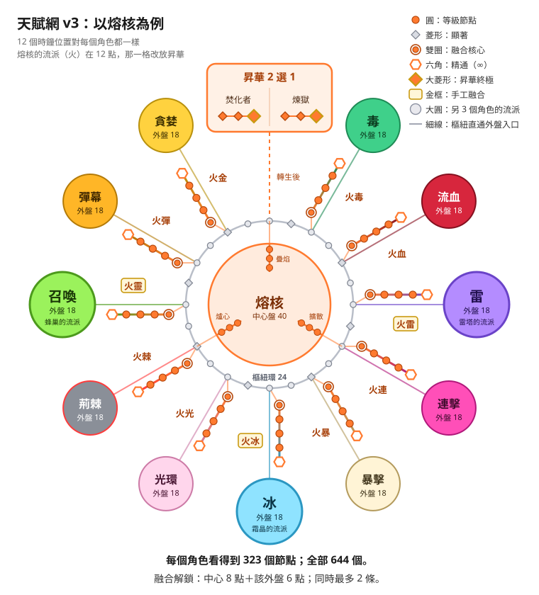
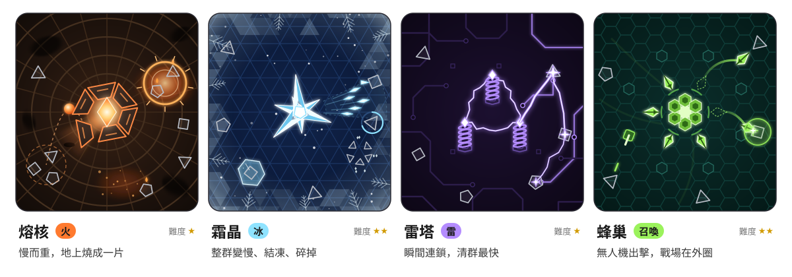

# 遊戲設計 v3：選流派就是選角色

> 2026-10-13 · 回應 Hoshi 當天的訊息：進遊戲時從所有流派選一個當中心盤（Hoshi 說的「中央盤」），選了它就是選了角色；中心盤可以和所有的盤點出特色分支（選了冰，就有冰毒、冰火、冰召喚；霜晶的這一條改叫「冰靈」，原因見 §0 第 3 點）；先做 4 個角色；美術要更有區分性，不能永遠是中間一個圓球。4 個角色由 Hoshi 當天在決策卡上選定：火、冰、雷、召喚。
> 實作方式、引擎增量、時程與給實作專案的指示在 [implementation-plan-v3.md](implementation-plan-v3.md)。兩份文件用小節編號互相引用。
> 所有數值都是**初始值**，交給平衡模擬器調整；遊玩時間是推論，信心低。角色名、招牌攻擊名與融合稱號都是暫定，Hoshi 可以改。
>
> **和 v2 的關係**：這份取代 v2 設計的四象限角色（狙擊手、術士、風暴使、工匠）、環狀天賦網與 8 個相鄰融合。v2 仍然有效的部分（12 個流派的規格與答案節點、敵人、菁英詞綴與 Boss、局外進度、介面、附錄的規則）都已經改寫併進這份，讀這份就夠，不用再看 v2。

## 0. 結論先講

1. **選角色就是選中心流派。** 首發 4 個角色：熔核（火）、霜晶（冰）、雷塔（雷）、蜂巢（召喚）。第一次啟動就 4 個全開，熔核標「第一次玩推薦」。角色之間不是換皮：招牌攻擊、中心盤、外觀、場地、昇華都不一樣。
2. **天賦網＝角色獨有的中心盤＋共用的樞紐環＋11 塊外盤＋11 條融合。** 外盤是其他 11 個流派的精簡版，全角色共用。全網 644 個節點（下限 500），每個角色看得到 323 個。一輪轉生約點 60–80 個，破關時約 120–150 個（推論），所以一定要選。
3. **中心盤和每一塊外盤都能融合，名字中心在前。** 熔核有火冰、火毒，霜晶有冰火、冰毒；蜂巢照 Hoshi 的說法叫火召喚、冰召喚、毒召喚。**和 Hoshi 的例子只差一處：霜晶接召喚外盤叫「冰靈」，不叫冰召喚。** 蜂巢已經有一條冰召喚，同名會分不清。元素角色接召喚外盤都會生出有壽命的幫手（火靈、冰晶哨、電蜂），所以統一叫「X靈」（§5.1）。想改回冰召喚，就要幫蜂巢那條換名字。每塊外盤都點得出融合，但同時最多裝 2 條（任一角色擊敗奇點後 3 條），這樣組合才測得完，也逼玩家做選擇。44 條融合裡，4 個角色流派之間的 12 條手工寫規則，其餘 32 條是「中心事件 × 外盤酬載」的模板。冰火和火冰是兩種打法，因為觸發和主要傷害永遠是中心的。
4. **每種敵人考一個問題。** 每個角色天生剋的、怕的都不同（§6）；怕的每一種（寶藏怪除外），在自己的中心盤都有答案節點。外盤是第二種解法，也是 build 變化的來源。
5. **角色不再是中間一顆球。** 模擬裡角色仍然固定在中央（M1 的敵人位置是相對角色計算的，角色一動，整波敵人會跟著平移），但畫面上換成 4 種多部件構造體，各有自己的攻擊語言與場地；蜂巢的無人機出擊時，中央會整個空掉。
6. **Demo 是熔核＋蜂巢**，Hoshi 舉的火召喚、冰召喚、毒召喚都在裡面。遊戲有終點：第 100 波的最終 Boss「奇點」＝破關，之後是無盡模式與挑戰。

## 1. 四個角色

**一局怎麼進行（沿用 M1）**：角色固定在畫面中央，敵人從邊緣一波波生成、朝中央走；碰到角色就造成接觸傷害並消失（漏怪）。角色全自動攻擊，局中沒有選擇，只能切 1x／2x／4x 速度。每波約 2 秒生完，清空或 12 秒到就出下一波；每 5 波有菁英、每 10 波有 Boss。生命歸零或 3 分鐘到，一局結束，拿碎片與核心回天賦網配點（洗點免費），再開下一局。起始波次可以選（M1 的選擇器與跳波補償照舊）。

**名詞**：
- **攻擊**：招牌攻擊的一次出手。熔核是一發熔岩彈，霜晶是一輪冰錐，雷塔是一次放電，蜂巢是一次無人機撞擊或一發砲台射擊。外盤效果都掛在「你的攻擊」上，所以同一塊毒外盤，在熔核身上是爆炸上毒，在蜂巢身上是無人機上毒。
- **擊中傷害**：基礎 10（M1）。角色生命 100（M1）。
- **答案節點**：對付某種敵人的顯著節點，標「答案：盾兵」這類字樣（§6）。
- **主要目標**：熔岩彈＝爆炸範圍內離落點最近的 1 隻；冰錐扇＝這一輪第一個被打中的敵人；三相雷＝放電的第一個目標；無人機＝撞擊目標；砲台＝那一發的目標。「從主要目標」出發的效果每次攻擊只算 1 次。

| 角色 | 流派 | 主色 | 招牌攻擊 | 一句話 | 難度 |
|---|---|---|---|---|---|
| **熔核** | 火（燃燒） | 橘 #FF7A2F | 熔岩彈 | 慢節奏的大爆炸，地上燒成一片 | ★ |
| **霜晶** | 冰 | 冰藍 #8FE3FF | 冰錐扇 | 整群變慢、凍住、一起碎掉 | ★★ |
| **雷塔** | 雷（連鎖） | 紫電 #B48CFF，白芯 | 三相雷 | 沒有飛行時間，閃電一瞬間跳滿畫面 | ★ |
| **蜂巢** | 召喚（砲台併入） | 黃綠 #9BF25C | 蜂群 | 本體不攻擊，戰場在畫面外圈 | ★★ |

### 1.1 選角畫面與第一次啟動

- **4 個角色從第一次啟動就全部能選**，沒有用波次解鎖角色。進度感交給每個角色自己的轉生、外盤揭露（§2.4）和全帳號的傳承（§7）。
- 選角畫面有 4 張卡，每張卡上：
  - 這個角色的構造體站在自己的場地上，跑一段**固定 seed 的真實模擬**，10 秒一循環（模擬是純函式，成本很低）。
  - 一句話介紹、難度星（熔核★、雷塔★、霜晶★★、蜂巢★★）。
  - 天生剋的敵人與怕的敵人圖示（§6.4 的那一列）。
- 游標預設在熔核，卡上標「**第一次玩推薦**」。
- 前 3 局的結算畫面顯示「**換一個角色試試**」，選錯不會卡住。之後在主選單隨時能切換。
- 每個角色各自存進度（配點、碎片、核心、最遠波次、轉生、昇華、融合槽、3 組配置）。
- Demo 裡霜晶與雷塔也在選角畫面上、有動畫，但鎖住，標「完整版」（§10）。

### 1.2 熔核（火）

**招牌攻擊「熔岩彈」**
- 每秒 1.5 發，拋向敵人最密集的地方，0.4 秒後落地。
- 落地爆炸：半徑 60、150% 傷害，必定點燃，觸發中心事件「**爆炸**」（§5.3）。
- 留下 1.5 秒火地，每秒 30% 傷害。
- 燃燒照 M1：每秒造成擊中傷害的 150%、持續 1.2 秒、最多 5 層；不受護盾與堅甲影響；燃燒中的敵人不能回血。

**中心盤**（◆＝顯著節點）

| 分支（等級節點加什麼） | ◆ | 效果 |
|---|---|---|
| 疊焰（燃燒傷害、層數上限） | 悶燒 | 燃燒持續 +2 秒、層數上限 +3 |
| | 引火 | 燃燒中的敵人受到擊中傷害 +15% |
| | 白熱 | 同一隻敵人燃燒滿 5 層時，下一發熔岩彈對牠 ×2 |
| 擴散（爆炸半徑、擴散距離） | 瘟疫 | 燃燒的敵人死時，把 40% 的燃燒傳給半徑 250 內的敵人（M1 的關鍵天賦降級）。**答案：三角** |
| | 餘燼彈 | 燃燒的敵人死時，朝最近的敵人射一顆小火球 |
| | 連環爆 | 被熔岩彈打死的敵人在原地再爆一次（半徑 40、50% 傷害），每發最多 2 次 |
| 爐心（熔岩彈頻率、傷害） | 熱浪 | 每 5 秒把 200 內的敵人推回 80（模擬裡就是距離 +80）。**答案：衝刺者** |
| | 遠投 | 每第 4 發改丟最遠的敵人。**答案：召喚者** |
| | 引爆 | 燃燒層數滿時爆炸，一次打出剩下的燃燒傷害（無盡烈焰下改成 ≥ 5 層） |

- ★ **無盡烈焰**（M1 已有）：燃燒層數沒有上限；燃燒持續時間 −50%。
- ★ **火山**：每 3 秒丟 1 發巨彈，半徑 ×3、傷害 ×5；其他時間不攻擊。
- 門檻「**火環**」（中心盤點滿 12 個後）：每 6 秒從角色放出一圈半徑 300 的火焰新星，50% 傷害並點燃碰到的敵人。
- 昇華：**焚化者**／**煉獄**（細節見下面，規則見 §1.7）。

| 昇華 | ◆ | ◆ | 終極 |
|---|---|---|---|
| 焚化者 | 焚屍：燃燒中的敵人死時爆炸，打出牠剩下的燃燒傷害（M1 的昇華規則） | 助燃：焚屍的爆炸點燃 2 層 | 連環焚燒：被焚屍爆炸打死的敵人也會焚屍（深度上限 3） |
| 煉獄 | 熔流：火地持續時間 ×2 | 灼地：火地每秒傷害 30% → 50% | 火海：相連的火地合成一片，傷害 ×2 |

| 三角 | 方塊 | 五角 | 盾兵 | 再生 | 衝刺 | 射手 | 召喚者 | 寶藏 | Boss |
|---|---|---|---|---|---|---|---|---|---|
| △ | ✓ | △ | ✓ | ✓ | ✗ | △ | ✗ | ✗ | ✓ |

- ✗ 的答案：衝刺者→熱浪、召喚者→遠投（寶藏怪是獎勵，不強制）。
- 推薦外盤（開局揭露）：冰、暴擊、召喚。
- **玩起來**：節奏慢、爆炸大，數字在燒滿的那一刻最大。打硬目標（盾兵、再生者、Boss）強；怕跑得快的衝刺者和躲在外圈的召喚者。

### 1.3 霜晶（冰）

**招牌攻擊「冰錐扇」**
- 每秒 2.5 輪，每輪 5 支冰錐排成 30° 扇形，每支 40% 傷害、穿透 1，命中時冰冷 +10%。

**冰的規則**（霜晶和冰外盤共用）
- 每隻敵人有一個**冰冷量表**（0–100%）。減速隨冰冷增加，上限一般 30%、Boss 15%。
- 一般敵人到 100% 時**凍結** 1.2 秒，觸發中心事件「**凍結**」（§5.3）；結束後量表歸零，3 秒內不再累積。
- 凍結中的敵人受到傷害 +30%。凍結中被擊殺會**碎裂**：對半徑 90 內的敵人造成牠最大生命 15% 的傷害。
- **Boss 不會凍結**，但量表到 100% 時仍然觸發「凍結」事件，然後歸零，之後 4.2 秒不再累積（等於一般敵人的凍結 1.2 秒＋免疫 3 秒）。所以冰的融合打 Boss 也有效，但不會比打一般敵人更頻繁。

**中心盤**

| 分支（等級節點加什麼） | ◆ | 效果 |
|---|---|---|
| 寒霜（冰冷累積、減速） | 冰河 | 減速上限 +15% |
| | 冰脆 | 每 10% 冰冷，受到傷害 +6%，對 Boss 也有效。**答案：Boss** |
| | 凍土 | 凍結的敵人周圍 60 變成 2 秒霜地，踩到的敵人每秒冰冷 +20% |
| 碎裂（碎裂傷害、碎裂範圍） | 連鎖碎裂 | 被碎裂打死的敵人也會碎裂 |
| | 粉碎 | 凍結中死亡的五角不分裂 |
| | 冰柱 | 每第 4 輪改射 1 支 400% 的大冰錐。**答案：盾兵** |
| 冰壁（最大生命、回復） | 冰霜新星 | 敵人進入 120 範圍時放出冰霜新星，冷卻 4 秒 |
| | 凍結生機 | 有冰冷的敵人回血 −80%。**答案：再生者** |
| | 霜甲 | 每次凍結事件給你 2% 最大生命的護盾，上限 30% |

- ★ **絕對零度**：場上所有敵人永遠帶 30% 減速，凍結沒有免疫時間；你的攻擊頻率 −25%。Boss 的凍結事件仍至少間隔 1 秒。
- ★ **稜鏡**：只射 1 支冰錐，無限穿透，每穿透 1 隻傷害 +20%（加算，最多 +200%）。（和 Boss「稜鏡」同名，上市前改掉其中一個。）
- 門檻「**暴風雪**」：每 10 秒在敵人最密集處降下暴風雪：半徑 200、持續 2 秒，每 0.25 秒讓範圍內的敵人冰冷 +10% 並受到 15% 傷害。

| 昇華 | ◆ | ◆ | 終極 |
|---|---|---|---|
| 冰后 | 冰封：凍結時間 +50% | 寒冠：凍結中的敵人受到傷害 +30% → +50% | 冰后之握：碎裂會凍結半徑 90 內的敵人 |
| 永冬 | 酷寒：減速上限 +20%（一般 50%、Boss 35%） | 霜蝕：Boss 的冰冷累積 ×1.5 | 永夜：Boss 每 10 秒可以被凍結 0.5 秒 |

| 三角 | 方塊 | 五角 | 盾兵 | 再生 | 衝刺 | 射手 | 召喚者 | 寶藏 | Boss |
|---|---|---|---|---|---|---|---|---|---|
| ✓ | △ | ✓ | ✗ | ✗ | ✓ | △ | △ | ✓ | ✗ |

- ✗ 的答案：盾兵→冰柱、再生者→凍結生機、Boss→冰脆。
- 推薦外盤（開局揭露）：火、毒、暴擊。
- **玩起來**：控場。整群先變慢、凍成雕像，再一起碎掉，漏怪最少。群怪與衝刺者強；怕盾兵、再生者和 Boss 這種要硬打的目標。

### 1.4 雷塔（雷）

**招牌攻擊「三相雷」**
- 3 個線圈輪流放電，合計每秒 3 次，瞬間命中，沒有飛行時間。
- 連鎖 2 次，每跳保留 70% 傷害（M1）。每一跳觸發中心事件「**跳躍**」的判定（§5.3）。
- 被打到的敵人**感電**：2 秒內受到傷害 +10%／層，最多 3 層。
- 每次攻擊最多命中 32 隻；規則帶來的額外跳合計最多 +2（效能與平衡的上限）。

**中心盤**

| 分支（等級節點加什麼） | ◆ | 效果 |
|---|---|---|
| 分岔（連鎖次數、跳躍範圍） | 分岔 | 每跳分成 2 道 |
| | 回彈 | 沒有其他目標時跳回同一隻，最多 2 次。**答案：Boss** |
| | 長弧 | 連鎖跳躍範圍 +60% |
| 增幅（保留率、閃電傷害） | 蓄電 | 第 3 跳起每跳傷害 +15%，不再衰減 |
| | 破盾電弧 | 連鎖擊中無視護盾。**答案：盾兵** |
| | 過電 | 感電滿 3 層的敵人被擊中時，額外受到一次 50% 傷害 |
| 風暴（感電層數、感電效果） | 麻痺 | 被連鎖打到的敵人 2 秒內不能回血 |
| | 靜電爆發 | 感電的敵人死時，朝最近的敵人放一道小閃電 |
| | 落雷 | 每 3 秒一道落雷，打感電層數最多的敵人，300% 傷害 |

- ★ **過載**（M1 已有）：連鎖次數 ×2，連鎖傷害 +350%（more）；保留率 −20 個百分點。
- ★ **六線圈**：線圈 +3，每次放電傷害 −45%，同時打 2 個目標。合計每秒 6 次（每個線圈每秒 1 次）；兩個目標合計仍受每次攻擊最多命中 32 隻的上限。
- 門檻「**雷網**」：每隻感電的敵人連到 200 內最近的 2 隻感電敵人。每 0.25 秒判定一次，壓在任何一條線上的敵人（含線段兩端）受到 10% 擊中傷害並感電，每隻每次判定最多算一次。

| 昇華 | ◆ | ◆ | 終極 |
|---|---|---|---|
| 暴風眼 | 渦流：第一跳分岔成 3 道 | 暴風：感電上限 +3 層 | 風暴之眼：每累積 50 跳，落雷打所有感電的敵人 |
| 避雷塔 | 避雷針：場地四角各立一座塔（不攻擊、不會被打），每次放電 25% 機率也從最近的塔起跳一次 | 導雷：從塔起跳的連鎖 +2 跳 | 天罰：感電的 Boss 每秒挨 1 次落雷（200% 傷害） |

| 三角 | 方塊 | 五角 | 盾兵 | 再生 | 衝刺 | 射手 | 召喚者 | 寶藏 | Boss |
|---|---|---|---|---|---|---|---|---|---|
| ✓ | △ | ✓ | ✗ | △ | ✓ | ✓ | ✓ | △ | ✗ |

- ✗ 的答案：盾兵→破盾電弧、Boss→回彈。
- 推薦外盤（開局揭露）：火、暴擊、毒。
- **玩起來**：最快。閃電一瞬間跳滿畫面，打得到後排的射手和召喚者。單體弱，盾兵和 Boss 要靠答案節點或外盤。

### 1.5 蜂巢（召喚）

v2 的「砲台」流派併進召喚：砲台就是不會動的無人機。

**招牌攻擊「蜂群」**：3 架無人機＋1 座砲台，**本體自己不攻擊**。
- **無人機**：平常停在蜂巢外圈的停靠環上。出擊時以速度 600 衝向目標，場地內沒有射程限制，優先打外圈的敵人。撞擊造成 200% 傷害，加上半徑 40 的濺射（所以對三角是 △，不是 ✗），觸發中心事件「**撞擊**」（§5.3）。同一隻敵人 0.5 秒內不再撞；撞 3 次後回巢。
- **攻擊頻率對無人機**：衝刺速度與回巢速度乘上攻擊頻率倍率，停靠時間（初始值 0.5 秒）與同一隻的撞擊冷卻（0.5 秒）除以這個倍率。例：攻擊頻率 +50% → 速度 ×1.5、停靠 0.33 秒。砲台照一般發射器。
- **砲台**：固定在半徑 90，80% 傷害；攻擊頻率是角色基礎的 50%（M1 基礎每秒 4 次，所以每秒 2 發）。
- 限制見 §1.6。

**中心盤**

| 分支（等級節點加什麼） | ◆ | 效果 |
|---|---|---|
| 蜂群（無人機傷害、速度） | 分巢 | 每 5 次擊殺生出 1 架臨時無人機，存在 6 秒 |
| | 自爆協議 | 無人機回巢前的第 3 次撞擊改成爆炸，半徑 80、150% 傷害 |
| | 蜂后 | 1 架無人機變成蜂后：體型 ×1.5、傷害 ×2；其他無人機打蜂后的目標時傷害 +20% |
| 工兵（砲台傷害、攻擊頻率） | 量產 | 砲台 +2，每座傷害 −20% |
| | 前哨 | 砲台改放在半徑 220，射程更遠 |
| | 集火指令 | 所有召喚物打生命最高的敵人，傷害 +25%。**答案：Boss** |
| 守衛（最大生命、撞擊範圍） | 攔截守衛 | 2 架無人機改在半徑 120 繞行，優先撞正在蓄力的衝刺者。**答案：衝刺者** |
| | 重錘 | 1 架無人機傷害 ×5、速度 ×0.4。**答案：盾兵** |
| | 回收 | 無人機回巢後立刻再出擊，不在停靠環停留 |

- ★ **巨像**：只剩 1 架無人機；每少 1 架，牠的傷害 +50% 並變大。
- ★ **蟲海**：無人機數量 ×2，每架傷害 −45%，撞完不回巢，直接找下一個目標（仍受全場上限 24 限制）。
- 門檻「**蜂潮**」：每 8 秒，全部無人機一起俯衝到最密集處，傷害 ×2。

| 昇華 | ◆ | ◆ | 終極 |
|---|---|---|---|
| 機械師 | 增建：砲台 +2 | 聯動砲：砲台的射擊也帶半徑 40 的濺射 | 母艦工廠：每座砲台每 6 秒放出 1 架 4 秒的臨時無人機 |
| 女王 | 擴巢：無人機 +3 | 蜂王漿：臨時無人機存在時間 +50% | 繁衍：擊殺時 20% 機率生出 6 秒的臨時無人機 |

| 三角 | 方塊 | 五角 | 盾兵 | 再生 | 衝刺 | 射手 | 召喚者 | 寶藏 | Boss |
|---|---|---|---|---|---|---|---|---|---|
| △ | △ | △ | ✗ | △ | ✗ | ✓ | ✓ | ✓ | △ |

- ✗ 的答案：盾兵→重錘、衝刺者→攔截守衛。
- 推薦外盤（開局揭露）：火、冰、暴擊。
- **玩起來**：戰鬥發生在畫面外圈，打後排和寶藏怪最強。被衝刺者和貼身的群怪逼近時最弱。

### 1.6 召喚物的限制

Hoshi 在 2026-10-12 把召喚排除過，原因是召喚物的 AI、移動與找目標，工時約是連鎖的 2–3 倍。v3 把召喚找回來，但 AI 只到「找目標 → 直線衝過去 → 撞擊 → 回巢」為止，成本壓住。下面這些限制也寫進 CLAUDE.md，內容批次裡不能放寬：

| 限制 | 內容 |
|---|---|
| 沒有生命 | 不會被打壞；靈與臨時無人機用存在時間代替生命 |
| 不尋路 | 直線移動，穿過一切 |
| 不被瞄準 | 敵人永遠不打召喚物，也不會被牠們擋住 |
| 不碰撞 | 召喚物之間、召喚物和敵人之間都沒有碰撞；撞擊只是距離判定 |
| 更新順序 | 依實體 ID，保證同一個 build＋同一個 seed 結果一樣 |
| 找目標 | 每 0.5 秒才重新找一次。例外：守衛模式的無人機在衝刺者開始蓄力的那個 tick 就換目標（事件觸發）。已經有無人機在追的敵人排在後面（和 M1 投射物的 inbound 一樣） |
| 數量 | 全場上限 24，臨時的也算。滿了就不再生新的 |
| 統一實作 | 砲台＝速度 0 的無人機；靈（火靈、電蜂）＝有壽命的無人機；冰晶哨＝有壽命的砲台 |

- 召喚物用角色的擊中修正，所以外盤效果也掛在牠們身上：接毒外盤，無人機會上毒。
- 任何角色點召喚外盤（§4.10）也會得到無人機，規則相同。

### 1.7 昇華

- 每個角色**各自**在第 30 波可以轉生（§7）。轉生後從自己的 2 個昇華選 1 個，用迴響點；可以和上次選的不同。
- 每個昇華 3 個節點：2 個 ◆＋1 個終極。共 8 個昇華、24 個節點。
- 昇華畫在天賦網上**自己流派那一格**（熔核在 12 點、雷塔在 3 點、霜晶在 6 點、蜂巢在 9 點），轉生前鎖住。
- 昇華不算在「關鍵天賦最多 2 個」裡。終極是規則模組（要寫程式），◆ 是資料。

| 角色 | 昇華 A | 昇華 B |
|---|---|---|
| 熔核 | 焚化者：燒死就爆炸，爆炸會連環 | 煉獄：火地變久、變痛、連成火海 |
| 霜晶 | 冰后：凍得更久，碎裂會凍住周圍 | 永冬：減速更深，最後連 Boss 都凍得住 |
| 雷塔 | 暴風眼：分岔更多、感電更深、累積落雷 | 避雷塔：場地四角的塔當起跳點，落雷追打 Boss |
| 蜂巢 | 機械師：更多砲台，砲台會放無人機 | 女王：更多無人機，擊殺會生出新的 |

## 2. 天賦網結構

### 2.1 區塊與節點預算

| 區塊 | 數量 | 每個 | 小計 | 組成 |
|---|---|---|---|---|
| 中心盤（角色獨有） | 4 | 40 | 160 | 招牌攻擊 1；3 個分支各 10（6 等級＋3 ◆＋1 ∞ 精通）；★ 2；門檻 1（中心盤點滿 12 個後）；接口 6（等級節點，接樞紐與輻條） |
| 樞紐環（共用） | 1 | 24 | 24 | 強化∞ 1；等級 13；◆ 8；★ 2 |
| 外盤（共用） | 12 | 18 | 216 | 入口 1（任何角色點了就有這個流派的基本來源）；2 個分支各 7（4 等級＋2 ◆＋1 ∞）；答案 ◆ 1；★ 1；門檻 1（本盤點滿 8 個後） |
| 融合分支 | 44 | 5 | 220 | ◆ 融合核心在第一個（規則本身，點下去 2 秒內畫面看得出差別）；等級 3；∞ 精通 1 |
| 昇華 | 8 | 3 | 24 | 2 ◆＋1 終極；轉生後 2 選 1；畫在自己流派那一格 |
| **合計** | | | **644** | |

- 驗算：中心盤 1＋30＋2＋1＋6＝40；外盤 1＋14＋1＋1＋1＝18；160＋24＋216＋220＋24＝644。
- **每個角色看得到 323 個**：自己的中心盤 40＋樞紐環 24＋11 塊外盤 × 18（198）＋11 條融合 × 5（55）＋自己的 2 個昇華 × 3（6）。
- 自己的流派不會出現在外盤（熔核看不到火外盤），那一格放昇華。所以 4 個角色的網只差在「中間換一個盤、外圈空出的那一格不同」。
- 關鍵天賦節點共 22 個：中心 8、外盤 12、樞紐 2。外盤的火、冰、雷、召喚 4 個 ★ 和中心盤共用規則，所以不重複的規則是 18 條。每個角色看得到 15 個（中心 2＋樞紐 2＋外盤 11），不會重複。
- 中心盤的 6 個接口加傷害、攻擊頻率、生命這類通用數值。

**樞紐環**（24 個節點，所有角色共用；去任何外盤都要經過，路上的節點本身就有用）

| 群組 | 等級節點 | ◆ | ★ |
|---|---|---|---|
| 強化 | 強化∞（M1 已有：每級所有傷害 ×1.10，獨立計價，零錢的去處；不套用到碎裂，見下方註） | | |
| 防禦 | 5 個（最大生命、回復、接觸傷害減免、擊殺回血等） | 第二條命：每局一次，死時回 50% 生命<br>波次護盾：每波開始得到 20% 最大生命的護盾 | |
| 經濟 | 4 個（碎片、核心、跳波補償等） | 菁英賞金：菁英與 Boss 掉落 ×2<br>寶藏嗅覺：寶藏怪出現率 +50% | |
| 回響 | 4 個（攻擊頻率、範圍、持續時間、投射物速度） | 多重施法：每 20 次攻擊充能，下一次連放 3 次<br>回聲：每第 5 次攻擊重複上一擊（50%）<br>擊殺爆炸：擊殺時 10% 機率爆炸（半徑 60、50% 傷害）<br>新星：每 5 秒放一圈新星（半徑 200） | |
| 規則 | | | 玻璃大砲（M1 已有）：所有傷害 ×2（more）；生命變成 1<br>巨大化：範圍、爆炸、投射物、無人機的大小 ×2；數量類（投射物、冰錐、連鎖跳數、無人機）減半，一律無條件捨去，最少 1 |

驗算：1＋5＋4＋4＝14 個等級類（含強化∞），◆ 2＋2＋4＝8，★ 2，合計 24。回響群是任何角色都用得到的「多打幾次」。

註：強化∞ 不套用到碎裂（§1.3）。碎裂按死者最大生命計算，只吃中心盤與融合的條件加成（「對…的敵人」「每…」這類）和玻璃大砲的 ×2；強化∞、精通這類沒有上限的節點都不算，否則 %最大生命傷害會被整個 build 的倍率放大。

### 2.2 實作分類

| 類型 | 數量 | 內容 | 怎麼做 |
|---|---|---|---|
| 模板等級節點 | 430 | 中心 108（每盤 18 等級＋3 ∞＋6 接口）、樞紐 14（13 等級＋強化∞）、外盤 132（每盤入口 1＋8 等級＋2 ∞）、融合 176（每條 3 等級＋1 ∞） | 模板產生，只填屬性與數值 |
| 資料驅動顯著 | 168 | 中心 ◆ 與門檻 40（每盤 9＋1）、樞紐 ◆ 8、外盤 ◆／答案／門檻 72（每盤 4＋1＋1）、模板融合核心 32、昇華 ◆ 16 | 觸發、條件、縮放的描述，不寫程式 |
| 規則模組 | 46 | 招牌攻擊 4、中心 ★ 8、外盤 ★ 12、樞紐 ★ 2、手工融合核心 12、昇華終極 8 | 寫程式，各有單元測試 |
| **合計** | **644** | | |

- 驗算：108＋14＋132＋176＝430；40＋8＋72＋32＋16＝168；4＋8＋12＋2＋12＋8＝46；430＋168＋46＝644。
- 外盤的火、冰、雷、召喚 4 個 ★ 重用中心盤的模組（無盡烈焰、絕對零度、過載、蟲海），所以不重複的模組是 **42 個**。M1 已經有 4 個：無盡烈焰、過載、玻璃大砲、冷靜狙擊（改當暴擊外盤的 ★），所以**要新寫 38 個**，和 v2 一樣多。
- 另外要寫的引擎部分（不算節點）：4 個中心事件、12 種外盤酬載、融合產生器。細節在實作計畫。
- 關鍵天賦綁在自己的流派上（M1 的規則）：外盤 ★ 的倍率只乘那個流派的標籤。例：熔核點雷外盤的過載，只有連鎖造成的傷害 +350%，熔岩彈本身不變。

### 2.3 融合插槽與解鎖

- **解鎖**：中心盤點了 ≥ 8 個節點，**而且**那塊外盤點了 ≥ 6 個節點，就能點那條融合的核心。
- **融合槽**：同時最多擁有 **2 個融合核心**。融合分支的等級節點與精通要先有核心才點得到，所以同時最多 2 條融合在作用。傳承「任一角色擊敗奇點」給全帳號第 3 個槽（§7）。
- **關鍵天賦**：同時最多 2 個。融合核心與昇華不算在內。
- **價格**：融合核心是碎片＋1 核心（附錄 A.1）。
- **洗點免費**，含融合核心。換一條融合等於退掉再點，這是撞牆後換 build 的成本保證。
- 融合進度畫在輻條上：「中心 8/8・毒 3/6」。上方插槽列顯示 2 個融合槽＋2 個關鍵天賦槽。
- 2 個槽讓組合數有界：每個角色 C(11,2)＝55 組雙融合，4 個角色共 220 組，模擬器每晚全跑。第 3 槽解鎖後是三融合：每個角色 C(11,3)＝165 組、共 660 組，每週跑一次（推論約 2.5 小時，在 GitHub Actions 單一 job 6 小時的上限內）。

### 2.4 外盤漸進揭露

新玩家一開始不用面對 11 塊外盤。外盤依**這個角色歷來的最遠波次**揭露（轉生後不會再藏起來）：

| 時機 | 揭露幾塊 | 熔核 | 霜晶 | 雷塔 | 蜂巢 |
|---|---|---|---|---|---|
| 開局 | 3（推薦外盤） | 冰、暴擊、召喚 | 火、毒、暴擊 | 火、暴擊、毒 | 火、冰、暴擊 |
| 第 15 波 | 6 | ＋毒、雷、荊棘 | ＋雷、流血、召喚 | ＋冰、流血、彈幕 | ＋毒、雷、荊棘 |
| 第 30 波 | 11（全部） | ＋其餘 5 塊 | ＋其餘 5 塊 | ＋其餘 5 塊 | ＋其餘 5 塊 |

- 推薦外盤都能補這個角色的 ✗（§6.5）：熔核的冰補衝刺者、召喚補召喚者；霜晶與雷塔的火、毒、暴擊補盾兵與 Boss（霜晶的再生者靠火與暴擊）；蜂巢的火、暴擊補盾兵，冰、火補衝刺者。
- 還沒揭露的外盤畫成「？」，不能點。
- 已揭露但還沒投資的外盤**收合成一個小圓**，只顯示名稱、圖示、能補哪些敵人；點了才展開。第一個小時畫面上大多只有中心盤、樞紐環和 1–2 塊展開的外盤。

### 2.5 點數預算

點不完，所以要選。數字是推論，模擬器驗證。

| 時間點 | 節點數 | 典型配置 |
|---|---|---|
| 一輪轉生 | 約 60–80 | 中心 25＋樞紐 12＋3 塊外盤各 8（24）＋2 條融合（核心 2＋等級 5）＝68 |
| 破關 | 約 120–150 | 中心 38＋樞紐 20＋5 塊外盤（16、14、12、12、10，共 64）＋2 條融合 10＋昇華 3＝135 |

- 一個角色破關時大約點到自己 323 個節點的 40%。4 個角色都玩過，才會看過大部分的網。
- **價格曲線要重調**：M1 的 `180 × 1.31^n` 在 60 分鐘只買得到約 20 個節點；v3 一輪要 60–80 個，成長率要降很多，由模擬器定。

## 3. 版面



- **中間**：中心盤，招牌攻擊在正中，3 個分支相隔 120° 放射；★ 與門檻在分支之間的外緣，6 個接口在最外圈。
- **第二圈**：樞紐環（24 個節點）。
- **外圈**：12 個固定的鐘點位置，**4 個角色都一樣**，換角色不用重新認路：

| 鐘點 | 12 | 1 | 2 | 3 | 4 | 5 | 6 | 7 | 8 | 9 | 10 | 11 |
|---|---|---|---|---|---|---|---|---|---|---|---|---|
| 外盤 | 火 | 毒 | 流血 | 雷 | 連擊 | 暴擊 | 冰 | 光環 | 荊棘 | 召喚 | 彈幕 | 貪婪 |

- 4 個角色流派在 12／3／6／9 點。自己流派那一格放昇華，轉生前鎖住。
- **輻條**：每一格都有一條輻條，從樞紐環直通外緣的外盤入口，所以點外盤不用先點融合。融合分支（5 個節點）畫在輻條旁邊，核心接在樞紐環上，用角色的主色，往外漸變成外盤的顏色。
- **上方插槽列**：融合 2 格＋關鍵天賦 2 格。
- **三段縮放**：遠景看中心盤、11 塊外盤的名稱（或「？」）、每條輻條的融合進度；中景看分支；近景看節點。
- 全部點亮時，角色的顏色從中心一路長到外緣，這是預告片的最後一幕（§12）。

## 4. 十二個外盤

12 塊外盤就是 v2 的 12 個流派，砲台併進召喚：流血、暴擊、彈幕、連擊、雷（連鎖）、光環、冰、火（燃燒）、毒、貪婪、召喚、荊棘。每個角色看得到自己以外的 11 塊。

**共同規則**
- **入口**：任何角色點了，就得到這個流派的基本來源（點燃機率、冰冷、+1 連鎖、+1 架無人機……）。
- **2 個分支**：從 v2 的 3 個分支裡挑最通用的 2 個，每個 7 個節點（4 等級＋2 ◆＋1 ∞）。
- **答案 ◆**：大多是被拿掉的那個分支裡的答案節點，這樣 v2 的答案節點幾乎都保留下來。
- **★**：v2 那個流派的關鍵天賦。倍率只乘這個流派的標籤（§2.2）。
- **門檻**：本盤點滿 8 個後才能點，一定是畫面上看得到的效果，也是每塊外盤的 GIF 素材。
- 效果一律掛在「你的攻擊」上（§1 的名詞）。
- **火、冰、雷、召喚這 4 塊是角色流派的外盤版**：比中心盤輕很多，內容也不同。外盤版沒有招牌攻擊，數值比中心版低，中心盤的招牌顯著節點與門檻不放進來（只有 ★ 共用規則）。每塊都另外寫了「和中心盤的差別」。

| 鐘點 | 外盤 | 主色 | 入口 | 答案 ◆ | ★ | 門檻 |
|---|---|---|---|---|---|---|
| 12 | 火 | 橘 #FF7A2F | 擊中 10% 點燃 | 灼熱地帶（衝刺者） | 無盡烈焰 | 燎原 |
| 1 | 毒 | 綠 #3FD08A | 擊中 15% 中毒 | 神經毒（衝刺者） | 致死毒素 | 毒爆 |
| 2 | 流血 | 深紅 #D7263D | 擊中 10% 流血 | 抗凝（再生者） | 大出血 | 血河 |
| 3 | 雷 | 紫電 #B48CFF | 每次攻擊多連鎖 1 次 | 遠雷（召喚者） | 過載 | 雷鳴 |
| 4 | 連擊 | 洋紅 #FF4FB8 | 開始累積連擊層數 | 節奏閃避（射手） | 無盡連擊 | 殘影 |
| 5 | 暴擊 | 白光 #FFF4D6 | 暴擊率 +5% | 碎裂暴擊（三角） | 冷靜狙擊 | 斬首線 |
| 6 | 冰 | 冰藍 #8FE3FF | 每次擊中冰冷 +8% | 霜徑（衝刺者） | 絕對零度 | 寒潮 |
| 7 | 光環 | 粉白 #FFD6EC | 半徑 160 的光環 | 聚能脈衝（盾兵） | 聖域 | 日冕 |
| 8 | 荊棘 | 鐵灰 #8A8F98＋紅閃 #FF3B3B | 荊棘傷害 300% | 拒馬（衝刺者） | 鐵處女 | 刺蝟 |
| 9 | 召喚 | 黃綠 #9BF25C | +1 架無人機 | 鎖定信標（Boss） | 蟲海 | 雷射柵欄 |
| 10 | 彈幕 | 琥珀 #FFB627 | 每次攻擊多射 2 發小彈 | 集火（盾兵） | 子彈地獄 | 彈雨 |
| 11 | 貪婪 | 金 #FFD23F | 持有碎片加成 | 買斷（再生者） | 守財奴 | 金山 |

### 4.1 火（12 點）

- **顏色與形狀**：橘 #FF7A2F；火焰、餘燼、焦痕。
- **機制**：燃燒照 M1（每秒擊中傷害的 150%、1.2 秒、最多 5 層；不受護盾與堅甲影響；燃燒中的敵人不能回血）。
- **入口「火種」**：你的擊中 10% 點燃。
- **火勢**（點燃機率、燃燒傷害）：◆**火上加油**：燃燒中的敵人受到擊中傷害 +10%；◆**長燃**：燃燒持續 +0.6 秒、層數上限 +2。
- **野火**（擴散距離、燃燒傷害）：◆**火星**：燃燒的敵人死時，點燃 90 內最近的 2 隻（**答案：三角**）；◆**焦痕**：燃燒的敵人死時留下 1 秒小火地（半徑 40、每秒 20%）。
- **答案 ◆ 灼熱地帶**：角色周圍 200 內的敵人減速 30%（**答案：衝刺者**；v2 爆燃分支保留下來的答案節點）。
- ★ **無盡烈焰**（和熔核共用規則）：燃燒層數沒有上限；燃燒持續時間 −50%。
- **門檻「燎原」**：燃燒中的敵人每秒把 1 層燃燒傳給 60 內最近的敵人，火沿著敵群蔓延。
- **和熔核中心盤的差別**：沒有熔岩彈、火地、白熱、熱浪、火山、火環；長燃 +0.6 秒對中心的悶燒 +2 秒。

### 4.2 毒（1 點）

- **顏色與形狀**：綠 #3FD08A；泡泡與毒雲。和蜂巢的黃綠只差 24°，靠形狀分：毒是圓泡泡、會冒、會破；無人機是實心箏形。
- **機制**：每層每秒 20% 擊中傷害、持續 4 秒；**層數沒有上限**、各自計時。越大隻、活越久的敵人越痛。
- **入口「淬毒」**：你的擊中 15% 中毒。
- **劇毒**（中毒機率、每層傷害）：◆**雙重劑量**：每次中毒上 2 層；◆**滲透**：被護盾擋下的擊中仍會上毒（**答案：盾兵**）。
- **傳染**（持續時間、擴散範圍）：◆**毒雲**：中毒的敵人死時留下 2 秒毒雲（**答案：三角**）；◆**傳染**：中毒的敵人死時把 50% 層數傳給最近 2 隻，五角的分裂體繼承層數（**答案：五角**）。
- **答案 ◆ 神經毒**：每 5 層毒減速 2%，最多 40%（**答案：衝刺者**）。
- ★ **致死毒素**：目標每有 10 層毒，毒傷 +10%（這些加成先相加，再當成一個 more 乘上去，最多 +300%）；你的擊中傷害 −50%。
- **門檻「毒爆」**：每 8 秒，層數最多的敵人引爆一半的毒層：這些毒層剩餘傷害的 50% 一次打出，另外 50% 平均傳給半徑 150 內最多 5 隻敵人。

### 4.3 流血（2 點）

- **顏色與形狀**：深紅 #D7263D；細長拖尾與滴落的血點。和熔核的橘只差 25°，靠形狀分：流血是細長拖尾與小點，熔岩彈是圓的落彈與圓形爆炸。
- **機制**：每秒 40% 擊中傷害、持續 4 秒；同一隻只算最強的一個。**移動中的敵人流血 ×3**，敵人一直往中央走，所以大部分時間都是 ×3。
- **入口「放血」**：你的擊中 10% 流血。
- **深創**（流血機率、流血傷害）：◆**深傷**：流血 +2 秒；◆**割裂**：流血無視護盾，被擋下的擊中仍會流血（**答案：盾兵**）。
- **追獵**（對遠處敵人的傷害、流血傷害）：◆**傷口撕裂**：停下來的敵人流血 ×2（**答案：射手、召喚者**）；◆**撕裂**：暴擊必定造成流血，流血以暴擊後的傷害計算（v2 融合「撕裂」的前半）。
- **答案 ◆ 抗凝**：流血的敵人不能回血（**答案：再生者**）。
- ★ **大出血**：流血最多疊 8 層，但失去移動 ×3。
- **門檻「血河」**：每 0.5 秒，流血的敵人讓身後（離中央更遠的一側）60 內的敵人也流血；畫面上畫成紅色軌跡（只在 render）。

### 4.4 雷（3 點）

- **顏色與形狀**：紫電 #B48CFF，白芯；鋸齒電弧。
- **機制**：連鎖照 M1：擊中後跳到附近、還沒被這次攻擊打中的敵人，每跳保留 70%。每次攻擊最多命中 32 隻。
- **入口「導電」**：你的每次攻擊從主要目標多連鎖 1 次。
- **電弧**（連鎖範圍、保留率）：◆**跳電**：每跳 20% 機率多跳 1 次（每次攻擊最多 +2）；◆**電荷**：第一跳不衰減。
- **靜電**（感電效果、連鎖傷害）：◆**帶電**：連鎖擊中造成感電（2 秒內受到傷害 +10%／層，最多 3 層）；◆**放電**：感電的敵人死時，朝最近 1 隻放一道閃電。
- **答案 ◆ 遠雷**：連鎖跳躍範圍 +100%，最後一跳改跳最遠的敵人（**答案：召喚者**）。
- ★ **過載**（M1，和雷塔共用規則）：連鎖次數 ×2，連鎖傷害 +350%（more）；保留率 −20 個百分點。
- **門檻「雷鳴」**：每 8 秒一道落雷打最密集處，從落點連鎖 4 次。
- **和雷塔中心盤的差別**：沒有三相雷、分岔、回彈、蓄電、破盾電弧、落雷、雷網；連鎖只多 1 次。

### 4.5 連擊（4 點）

- **顏色與形狀**：洋紅 #FF4FB8；殘影與節拍環。
- **機制**：連續攻擊時每次 +1 層（上限 20），每層攻擊頻率 +3%、傷害 +2%。1 秒沒有目標就歸零；被擊中（漏怪或被射中）掉一半。
- **入口「節拍」**：你的攻擊開始累積連擊層數。
- **動能**（層數上限、每層效果）：◆**慣性**：沒有目標時改成每秒掉 25%，不會歸零（**答案：三角**）；◆**爆發**：滿層時每第 5 次攻擊多打一次。
- **連打**（連打傷害、攻擊頻率）：◆**三連擊**：每次攻擊連發 3 次，第 2、3 次傷害 +25%／+50%；攻擊頻率 −30%；◆**迎擊**：衝刺中的敵人受到傷害 ×2（**答案：衝刺者**）。
- **答案 ◆ 節奏閃避**：≥ 15 層時，每 3 秒第一次被射中無效（**答案：射手**）。
- ★ **無盡連擊**：層數沒有上限，但被擊中時歸零。
- **門檻「殘影」**：滿層時每次攻擊留下殘影，0.3 秒後重複那一擊（50% 傷害）。

### 4.6 暴擊（5 點）

- **顏色與形狀**：白光 #FFF4D6；斬擊線與閃光。
- **機制**：暴擊率 × 暴擊倍率（基礎 5%、150%，M1）。
- **入口「要害」**：暴擊率 +5%。
- **精準**（暴擊率、對菁英與 Boss 的暴擊率）：◆**鎖定**：對生命最高的敵人暴擊率 +25%；◆**見血**：暴擊流血中的敵人時，立刻打出牠剩下的流血（v2 融合「撕裂」的後半）。
- **重擊**（暴擊倍率、擊中傷害）：◆**處決**：生命 < 30% 的敵人必定暴擊（**答案：再生者**）；◆**破甲**：暴擊無視堅甲。
- **答案 ◆ 碎裂暴擊**：暴擊時在目標處爆炸，半徑 80、20% 傷害（**答案：三角**）。
- ★ **冷靜狙擊**（M1 已有）：每第 3 次攻擊必定暴擊，暴擊倍率 ×1.5、暴擊傷害 +120%、攻擊頻率 +25%（都是 more）；不會隨機暴擊。
- **門檻「斬首線」**：暴擊會從目標朝攻擊方向畫出一道白色斬擊線（長 200、寬 24），線上的敵人受到 50% 傷害。

### 4.7 冰（6 點）

- **顏色與形狀**：冰藍 #8FE3FF；冰晶與碎片。
- **機制**：冰的規則見 §1.3（冰冷量表、凍結、碎裂、Boss 的凍結事件）。
- **入口「寒氣」**：你的每次擊中冰冷 +8%。
- **寒流**（冰冷累積、減速）：◆**霜咬**：冰冷 ≥ 50% 的敵人受到傷害 +15%；◆**深凍**：凍結時間 +0.4 秒。
- **碎冰**（碎裂傷害、碎裂範圍）：◆**寒爆**：碎裂範圍 +40%；◆**凍瘡**：冰冷 ≥ 30% 的敵人回血 −60%（**答案：再生者**）。
- **答案 ◆ 霜徑**：衝刺中的敵人每被擊中一次，冰冷 +25%（**答案：衝刺者**）。
- ★ **絕對零度**（和霜晶共用規則）：場上所有敵人永遠帶 30% 減速，凍結沒有免疫時間；你的攻擊頻率 −25%。Boss 的凍結事件仍至少間隔 1 秒。
- **門檻「寒潮」**：每 8 秒從角色放出一圈寒氣，碰到的敵人冰冷 +50%，畫面上一圈白霜往外擴散。
- **和霜晶中心盤的差別**：沒有冰錐扇、冰脆、冰柱、連鎖碎裂、冰霜新星、暴風雪；冰冷只靠你的擊中慢慢累積。

### 4.8 光環（7 點）

- **顏色與形狀**：粉白 #FFD6EC（v2 的淡紫改掉，避免和雷塔的紫電撞色）；光圈與旋轉球。
- **機制**：**光環**：角色周圍半徑 160，每秒 4 次脈衝，每次 25% 基礎傷害。**環繞球**：繞角色半徑 110，碰到造成 60% 基礎傷害，同一隻 0.5 秒只打一次。只打得到靠近的敵人，是最後一道防線。
- **入口「微光」**：得到光環。
- **光域**（光環範圍、脈衝傷害）：◆**弱化**：光環內的敵人受到傷害 +20%；◆**引力**：每 4 秒把場上最遠的 1 隻敵人拉到光環邊緣，Boss 除外（**答案：召喚者**）。
- **環繞**（球數、轉速；第一個等級節點給 2 顆環繞球）：◆**雙軌**：第二圈軌道，半徑 180；◆**攔截軌道**：環繞球擋下敵人的子彈（**答案：射手**）。
- **答案 ◆ 聚能脈衝**：每 4 次脈衝合成 1 次 ×4 的大脈衝，能破盾（**答案：盾兵**）。
- ★ **聖域**：光環範圍 ×1.6、光環傷害 ×2；你的招牌攻擊傷害 −50%。
- **門檻「日冕」**：每 8 秒，光環放出一次全螢幕脈衝：場上每隻敵人吃一次光環脈衝（100% 脈衝傷害）。

### 4.9 荊棘（8 點）

- **顏色與形狀**：鐵灰 #8A8F98＋紅色閃光 #FF3B3B；尖刺。紅閃和熔核的橘只差 20°，靠形狀分：荊棘是細長尖刺與一瞬間的閃光，不會留在地上。
- **機制**：配合漏怪規則。敵人碰到角色時**先吃荊棘傷害**（擊中傷害 ×300%）；被荊棘殺死就不算漏怪、不扣血、照樣掉碎片；殺不死才扣血。
- **入口「倒刺」**：得到荊棘。
- **尖刺**（荊棘傷害、荊棘範圍）：◆**尖刺彈**：每 3 秒朝最遠的敵人射一根尖刺（**答案：召喚者**）；◆**反射**：敵人的子彈反彈回去（**答案：射手**）。
- **反擊**（荊棘傷害、接觸傷害減免）：◆**尖刺新星**：被碰到時，對半徑 150 內所有敵人造成荊棘傷害，冷卻 1 秒；◆**荊棘纏繞**：Boss 碰到你時被定住 1 秒，每 0.25 秒吃一次荊棘傷害，扣血延後（**答案：Boss**）。
- **答案 ◆ 拒馬**：衝刺中的敵人碰到你時吃 3 倍荊棘傷害，並被彈回 80（**答案：衝刺者**）。
- ★ **鐵處女**：受到的接觸傷害 −50%，荊棘傷害 ×2；你的攻擊頻率 −40%。
- **門檻「刺蝟」**：角色周圍長出 6 根看得見的尖刺，每根每秒刺 1 次 200 內最近的敵人，造成荊棘傷害的 25%。

### 4.10 召喚（9 點）

- **顏色與形狀**：黃綠 #9BF25C；實心箏形的無人機、方形底座的砲台。
- **機制**：召喚物照 §1.5 與 §1.6 的規則。用角色的擊中修正，外盤效果也掛在牠們身上。v2 的砲台流派併在這裡。
- **入口「僚機」**：+1 架無人機（撞擊 80% 傷害＋半徑 40 濺射，規則同蜂巢）。
- **砲座**（砲台傷害、攻擊頻率；第一個等級節點給 1 座砲台）：◆**加農砲**：砲台攻擊頻率 ÷3、傷害 ×4、範圍爆炸（**答案：盾兵**）；◆**特斯拉塔**：砲台的攻擊連鎖 2 次。
- **機隊**（無人機傷害、速度）：◆**雙機**：+1 架無人機，每架傷害 −15%；◆**超頻**：每 10 秒所有召喚物攻擊頻率 ×3，持續 2 秒。
- **答案 ◆ 鎖定信標**：召喚物優先打菁英與 Boss，對牠們傷害 +30%（**答案：Boss**）。
- ★ **蟲海**（和蜂巢共用規則）：無人機數量 ×2，每架傷害 −45%，撞完不回巢。
- **門檻「雷射柵欄」**：每個召喚物和離它最近的另一個之間連起雷射（只連最近的配對）。每 0.25 秒判定一次，壓在任何一條線上的敵人（含線段兩端）受到 10% 擊中傷害並感電，每隻每次判定最多算一次。
- **和蜂巢中心盤的差別**：只有 1–2 架無人機和 1 座砲台，是幫手，不是本體；沒有分巢、重錘、攔截守衛、集火指令、蜂潮。

### 4.11 彈幕（10 點）

- **顏色與形狀**：琥珀 #FFB627；細長子彈。和熔核的橘相差 32°，也照形狀規則處理：彈幕是細長、直線、很多發；熔岩彈是圓的、拋物線、一次一發。
- **機制**：**小彈**是跟著你的攻擊一起射出的小投射物，每發是一次小擊中。
- **入口「副彈」**：每次攻擊多射 2 發小彈，各 25% 傷害，射向不同的敵人。
- **齊射**（小彈數量、小彈傷害）：◆**扇形**：小彈改成扇形射向同一個目標；◆**環射**：每第 6 次攻擊朝 12 個方向射出小彈。
- **分裂**（穿透、分裂）：◆**子母彈**：小彈擊殺時分裂成 3 發（分裂出來的不再分裂）；◆**聚焦**：場上只剩 1 個目標時，所有小彈都打它，傷害 +20%（**答案：Boss**）。
- **答案 ◆ 集火**：0.2 秒內打中同一隻的多發合併計算護盾門檻（**答案：盾兵**）。
- ★ **子彈地獄**：小彈數量 ×2，每發傷害 −40%，小彈會在場地邊緣反彈（最多 2 次）。
- **門檻「彈雨」**：每 10 秒有 2 秒，小彈數量 ×3。

### 4.12 貪婪（11 點）

- **顏色與形狀**：金 #FFD23F；金幣。
- **機制**：**持有碎片**（錢包＋本局）讓所有傷害 ×（持有碎片）^指數。指數 0.12 時，持有 1 萬約 ×3、1 億約 ×9；花掉 90% 只少約 24%，是取捨不是懲罰。
- **入口「錢包」**：指數 0.06（持有 1 萬約 ×1.7）。
- **存款**（指數，點滿約到 0.12）：◆**金庫**：錢包碎片算 1.5 倍；◆**撒幣**：每第 10 次攻擊丟出金幣：10 倍擊中傷害、無視護盾與堅甲，每枚花本局碎片 0.1%（**答案：盾兵**）。
- **利息**（利率）：每波結束拿本局碎片的一部分當利息，每次觸發利率提高 0.5 個百分點，最多 10%（初始值）；◆**複利**：利息也算進持有碎片加成；◆**獎勵波**：每 10 波的利息 ×3。
- **答案 ◆ 買斷**：生命 < 15% 的一般敵人直接擊殺，每次花本局碎片 0.2%（**答案：再生者**）。
- ★ **守財奴**：持有碎片加成的指數 ×1.5；天賦節點價格 +50%。
- **門檻「金山」**：持有的碎片在角色周圍堆成金色光圈，光圈內擊殺的敵人多掉 50% 碎片。

## 5. 融合

### 5.1 命名

- **中心在前**：熔核的叫火冰、火毒；霜晶的叫冰火、冰毒；雷塔的叫雷火、雷冰。
- **蜂巢照 Hoshi 的說法叫「X召喚」**：火召喚、冰召喚、雷召喚、毒召喚、血召喚；其他用兩字流派名：暴擊召喚、彈幕召喚、連擊召喚、光環召喚、貪婪召喚、荊棘召喚。
- **元素角色接召喚外盤叫「X靈」**：火靈、冰靈、雷靈。因為牠們會生出靈，也避免霜晶的「冰召喚」和蜂巢的冰召喚撞名。
- 外盤的一字簡稱：血、暴、彈、連（連擊）、雷、光（光環）、冰、火、毒、金、靈／召喚、棘。光環用「光」不用「環」，避免熔核的融合和熔核門檻「火環」撞名。
- **每條融合另有一個短稱號**，玩家主要記稱號。模板融合的稱號一律兩個字；手工融合裡冰晶哨、雷網蜂是三個字。
- ID：`fusion.<char>.<outer>.<slot>`，例如 `fusion.fire.poison.core`、`fusion.summon.ice.r2`。`<char>` 是 fire、ice、lightning、summon；`<slot>` 是 core、r1、r2、r3、mastery。

### 5.2 十二條手工融合

4 個角色流派之間的全部 12 種組合，兩個方向都有。每條的核心是一個規則模組（要寫程式）。

| 角色 | 融合「稱號」 | 規則（初始值） | 畫面 |
|---|---|---|---|
| 熔核 | 火冰「霜焰」 | 爆炸附加 30% 冰冷；有冰冷的敵人燃燒層數上限 +3；火地變成霜火地（減速 30%） | 橘色爆炸外圈一層白藍霜環；火地邊緣結霜 |
| 熔核 | 火雷「電漿」 | 每次爆炸，範圍內每隻燃燒的敵人朝最近的敵人放一道電弧（每次爆炸最多 3 道）；感電的敵人燃燒傷害 +30% | 爆炸中心竄出紫白電弧，火焰帶紫邊 |
| 熔核 | 火靈「爆靈」 | 每第 4 發熔岩彈生出 1 隻 4 秒的火靈，衝向最近的敵人爆炸並點燃 3 層（最多 6 隻） | 橘色小箏形帶黃綠尾光，撞上去炸成一團火 |
| 霜晶 | 冰火「熱震」 | 凍結事件點燃目標 2 層；凍結中的敵人被點燃時，挨一次 200% 擊中並解凍 | 冰殼裂出橘色紋路，解凍那一刻白光一閃 |
| 霜晶 | 冰雷「超導」 | 凍結事件朝最近的 3 隻敵人放電弧（每道冰冷 +20%）；感電的敵人冰冷累積 ×1.5 | 冰藍色的直線電弧，帶紫色細芯 |
| 霜晶 | 冰靈「冰晶哨」 | 碎裂時 25% 機率留下 5 秒的冰晶哨，會射冰錐（最多 4 座） | 地上長出小冰柱，頂端一點黃綠光 |
| 雷塔 | 雷火「引信」 | 每跳讓目標燃燒 +1 層；最後一跳引爆目標剩餘燃燒的 50% | 紫色鋸齒線帶橘色火星，最後一跳炸開一團火 |
| 雷塔 | 雷冰「冰鏈」 | 每跳冰冷 +15%；跳到凍結的敵人時傷害 ×2（不加跳數） | 電弧沿路留下冰晶點，打到凍結的敵人時亮白 |
| 雷塔 | 雷靈「電蜂」 | 每第 15 跳生出 1 隻 5 秒的電蜂，每秒放一道 2 跳的連鎖（最多 3 隻） | 紫色小箏形，尾端黃綠，周圍細電弧 |
| 蜂巢 | 火召喚「焰蜂」 | 無人機撞擊點燃 2 層；被無人機打死的燃燒敵人會爆炸（半徑 60） | 無人機填色換成火苗、橘色拖尾 |
| 蜂巢 | 冰召喚「霜蜂」 | 無人機撞擊冰冷 +12%；撞到凍結的敵人（Boss 除外）必定碎裂 | 無人機填色換成菱形冰晶、白霜拖尾 |
| 蜂巢 | 雷召喚「雷網蜂」 | 每 0.5 秒，每架無人機和離它最近的另一架之間拉一道電弧（只連最近的配對）；每 0.25 秒判定一次，壓在任何一條線上的敵人（含線段兩端）受到 10% 擊中傷害並感電，每隻每次判定最多算一次 | 無人機之間連紫白電弧，像一張移動的網 |

- 鏡像的 6 對：火冰／冰火、火雷／雷火、冰雷／雷冰、火靈／火召喚、冰靈／冰召喚、雷靈／雷召喚。每一對都是兩種打法（§5.5）。
- Hoshi 每條親自玩 5 分鐘（實作計畫 §7）。

### 5.3 模板融合：中心事件 × 外盤酬載

其餘 32 條不寫程式，由產生器組出來：

```
模板融合 = { on: 中心事件, do: 外盤酬載, bonus: 加成 }
```

**中心事件**（每個角色一個，來自招牌攻擊）

| 角色 | 事件 | 什麼時候 | 酬載落在哪 | 上限 |
|---|---|---|---|---|
| 熔核 | 爆炸 | 每顆熔岩彈爆炸 | 爆炸範圍內最多 5 隻 | 落點類酬載每次爆炸放 1 次 |
| 霜晶 | 凍結 | 冰冷量表到 100%（Boss 也算） | 目標與半徑 90 內最多 5 隻 | 落點類酬載以目標為中心放 1 次；酬載每秒最多 8 次（初始值），超過的凍結照常凍住，但不放酬載 |
| 雷塔 | 跳躍 | 每跳 30% 機率 | 被跳到的敵人 | 每次攻擊最多觸發 3 次 |
| 蜂巢 | 撞擊 | 每次無人機撞擊 | 撞擊目標 | 每次撞擊放 1 次 |

中心事件只由招牌攻擊本身觸發（實作計畫 §2.6 第 8 條）；霜晶的凍結例外，冰冷從哪裡來都算。

**外盤酬載**（每塊外盤一個）

| 外盤 | 酬載 | 類型 | 加成（bonus） |
|---|---|---|---|
| 流血 | 流血 4 秒 | 上狀態 | 流血中的敵人受到中心傷害 +20% |
| 暴擊 | 一條必定暴擊的斬擊線（從起點朝目標方向，長 300、寬 24，100% 傷害） | 落點 | 斬擊線傷害隨暴擊率成長（每 10% 暴擊率 +10%） |
| 彈幕 | 4 發小彈 | 落點 | 彈幕外盤每多 1 發小彈，這裡也多 1 發 |
| 連擊 | +1 連擊層 | 給自己 | 每 5 層連擊，中心傷害 +4% |
| 雷 | 2 跳電弧，帶 1 層感電 | 落點 | 感電中的敵人受到中心傷害 +20% |
| 光環 | 2 秒脈衝區（半徑 80） | 落點 | 區內的敵人受到中心傷害 +20% |
| 冰 | 冰冷 +25% | 上狀態 | 有冰冷的敵人受到中心傷害 +20% |
| 火 | 燃燒 2 層 | 上狀態 | 燃燒中的敵人受到中心傷害 +20% |
| 毒 | 毒 2 層 | 上狀態 | 中毒的敵人受到中心傷害 +20% |
| 貪婪 | 金幣擊中（10 倍擊中、無視護盾、不花碎片）；這條融合造成的擊殺碎片 +1% | 落點 | 金幣吃持有碎片加成 |
| 召喚 | 4 秒小無人機（算在上限 24 內） | 給自己 | 場上每有 1 架小無人機，中心傷害 +4%（最多 +20%） |
| 荊棘 | 荊棘新星，半徑 90 | 落點 | 新星吃荊棘外盤的全部加成 |

- **中心傷害**指角色自己的招牌來源：熔核是熔岩彈（含爆炸、火地與它點的燃燒），霜晶是冰錐與碎裂，雷塔是閃電的每一跳，蜂巢是無人機與砲台。
- **沒有傷害轉換**：中心攻擊的傷害、標籤和來源都不變；酬載是另外加上去的效果，帶外盤的標籤，傷害算在那條融合的來源。所以不會碰到「轉換合計 ≤ 100%」，蜂巢的無人機加成也不會因為融合而失效。
- **3 個等級節點**：酬載強度、觸發上限或機率、加成的百分比。**∞ 精通**：這條融合的傷害每級 ×1.04（more），和所有精通共用計價。
- **強度係數由模擬器校準**：強度用主曲線量：同樣投入、從同一波開始跑，最遠波次用小數（下一波已打掉的生命比例也算進去），再用 GDD §7 的血量曲線換算成等效傷害倍率；前線推進到標準血量 ×1.2 的位置＝+20%。第 26–50 波這只等於 1 波，所以一定要用小數波次。基準是「中心＋那塊外盤、不點融合」。44 條融合（含 12 條手工）都讀同一個係數，只乘這條融合的傷害與觸發機率（機率夾到 100%），不乘有上限的數值（減速、凍結時間、層數上限）。二分法範圍 0.1–10，到邊界還調不到 +20% 就標 FAIL，交給人改規則；校準後每個 seed 都要落在 10–30%。
- **覆寫**：模板可以逐條覆寫數值、文字、外觀或把核心換成另一組資料觸發。v2 的融合規則這樣重用：瘟疫爆彈成為**火毒**的覆寫、永凍成為**冰光**、雷暴環成為**雷光**。v2 撕裂的規則拆進流血外盤的「撕裂」與暴擊外盤的「見血」（§4.3、§4.6）。v2 的 8 個相鄰融合不再是融合。
- **蜂巢的外觀**：無人機的外框仍是箏形與黃綠亮邊（中心），填色、拖尾與撞擊特效換成外盤的顏色與形狀。毒召喚是綠色泡泡無人機，Hoshi 的例子就是這樣做出來的。裝 2 條以上融合時，第 1 槽換填色、第 2 槽換拖尾、第 3 槽換撞擊特效。11 種皮膚只是參數（形狀、顏色、拖尾），不各寫程式。

### 5.4 四十四條總表

「做法」欄：手工＝規則模組；模板＝產生器；模板＋覆寫＝產生器加一條覆寫。標 Demo 的 8 條在 Demo 裡（§10）。

**熔核**（事件：爆炸）

| 融合 | 稱號 | 做法 | 核心規則（初始值） | Demo |
|---|---|---|---|---|
| 火冰 | 霜焰 | 手工 | 見 §5.2 | ✓ |
| 火雷 | 電漿 | 手工 | 見 §5.2 | |
| 火靈 | 爆靈 | 手工 | 見 §5.2 | ✓ |
| 火毒 | 瘟爆 | 模板＋覆寫 | 爆炸讓最多 5 隻各中 2 層毒；覆寫（v2 瘟疫爆彈）：中毒的敵人被燒死時，把毒層傳給半徑 90 內的敵人 | ✓ |
| 火血 | 血焰 | 模板 | 爆炸讓最多 5 隻流血 4 秒 | |
| 火暴 | 爆斬 | 模板 | 每次爆炸從落點朝最近的敵人畫一條必定暴擊的斬擊線 | ✓ |
| 火彈 | 散火 | 模板 | 每次爆炸從落點朝四周射出 4 發小彈 | |
| 火連 | 疾焰 | 模板 | 每次爆炸 +1 層連擊 | |
| 火光 | 爐光 | 模板 | 每次爆炸在落點留下 2 秒脈衝區 | |
| 火金 | 熔金 | 模板 | 每次爆炸在落點丟 1 枚金幣 | |
| 火棘 | 火刺 | 模板 | 每次爆炸在落點放出半徑 90 的荊棘新星 | |

**霜晶**（事件：凍結）

| 融合 | 稱號 | 做法 | 核心規則（初始值） | Demo |
|---|---|---|---|---|
| 冰火 | 熱震 | 手工 | 見 §5.2 | |
| 冰雷 | 超導 | 手工 | 見 §5.2 | |
| 冰靈 | 冰晶哨 | 手工 | 見 §5.2 | |
| 冰毒 | 腐霜 | 模板 | 凍結時，目標與 90 內的敵人各中 2 層毒 | |
| 冰血 | 凍傷 | 模板 | 凍結時，目標與 90 內的敵人流血 4 秒 | |
| 冰暴 | 碎斬 | 模板 | 凍結時從目標畫一條必定暴擊的斬擊線 | |
| 冰彈 | 霰彈 | 模板 | 凍結時從目標朝四周射出 4 發小彈 | |
| 冰連 | 霜律 | 模板 | 凍結時 +1 層連擊 | |
| 冰光 | 永凍 | 模板＋覆寫 | 凍結時在目標留下 2 秒脈衝區；覆寫（v2 永凍）：區內的敵人每秒冰冷 +15%，在區內碎裂的敵人讓本波的脈衝區範圍 +5%（可疊，最多 +50%） | |
| 冰金 | 霜幣 | 模板 | 凍結時對目標丟 1 枚金幣 | |
| 冰棘 | 霜棘 | 模板 | 凍結時在目標放出半徑 90 的荊棘新星 | |

**雷塔**（事件：跳躍，每跳 30%、每次攻擊最多 3 次）

| 融合 | 稱號 | 做法 | 核心規則（初始值） | Demo |
|---|---|---|---|---|
| 雷火 | 引信 | 手工 | 見 §5.2 | |
| 雷冰 | 冰鏈 | 手工 | 見 §5.2 | |
| 雷靈 | 電蜂 | 手工 | 見 §5.2 | |
| 雷毒 | 毒弧 | 模板 | 跳躍時讓目標中 2 層毒 | |
| 雷血 | 赤弧 | 模板 | 跳躍時讓目標流血 4 秒 | |
| 雷暴 | 雷斬 | 模板 | 跳躍時從目標畫一條必定暴擊的斬擊線 | |
| 雷彈 | 散雷 | 模板 | 跳躍時從目標朝四周射出 4 發小彈 | |
| 雷連 | 雷鼓 | 模板 | 跳躍時 +1 層連擊 | |
| 雷光 | 雷域 | 模板＋覆寫 | 跳躍時在目標留下 2 秒脈衝區；覆寫（v2 雷暴環）：區內的敵人自動感電，每個脈衝區每 0.5 秒朝區內 1 隻敵人放 1 跳閃電 | |
| 雷金 | 電幣 | 模板 | 跳躍時對目標丟 1 枚金幣 | |
| 雷棘 | 電棘 | 模板 | 跳躍時在目標放出半徑 90 的荊棘新星 | |

**蜂巢**（事件：撞擊）

| 融合 | 稱號 | 做法 | 核心規則（初始值） | Demo |
|---|---|---|---|---|
| 火召喚 | 焰蜂 | 手工 | 見 §5.2 | ✓ |
| 冰召喚 | 霜蜂 | 手工 | 見 §5.2 | ✓ |
| 雷召喚 | 雷網蜂 | 手工 | 見 §5.2 | |
| 毒召喚 | 毒泡 | 模板 | 撞擊讓目標中 2 層毒；綠色泡泡無人機 | ✓ |
| 血召喚 | 血蛭 | 模板 | 撞擊讓目標流血 4 秒；暗紅拖尾與血滴 | |
| 暴擊召喚 | 刃翼 | 模板 | 撞擊時沿飛行方向畫一條必定暴擊的斬擊線；白色刃形 | ✓ |
| 彈幕召喚 | 機砲 | 模板 | 撞擊時朝四周射出 4 發小彈；琥珀細彈 | |
| 連擊召喚 | 疾翼 | 模板 | 撞擊 +1 層連擊；洋紅殘影 | |
| 光環召喚 | 螢火 | 模板 | 撞擊在目標留下 2 秒脈衝區；粉白光圈 | |
| 貪婪召喚 | 金蜂 | 模板 | 撞擊時對目標丟 1 枚金幣；金色 | |
| 荊棘召喚 | 棘甲 | 模板 | 撞擊時放出半徑 90 的荊棘新星；鐵灰尖刺 | |

- 每條模板融合的加成（bonus）照 §5.3 的酬載表，表裡不重複寫。
- 驗算：手工 3＋3＋3＋3＝12，模板 8＋8＋8＋8＝32，合計 44；每條 5 個節點，共 220。

### 5.5 冰火和火冰為什麼不一樣

1. **觸發永遠是中心的事件。** 冰火從凍結觸發，火冰從爆炸觸發，發生的時機、位置、頻率都不同。
2. **主要傷害永遠是中心的。** 冰火的主傷害仍是冰錐與碎裂，火只是凍結之後補的一記重擊；火冰的主傷害仍是熔岩彈與燃燒，冰只負責控場。
3. **主色永遠是中心的**，外盤的顏色只當點綴。

| | 火冰「霜焰」（熔核） | 冰火「熱震」（霜晶） |
|---|---|---|
| 觸發 | 每次爆炸 | 凍結事件 |
| 主傷害 | 熔岩彈、火地、燃燒 | 冰錐、碎裂 |
| 補什麼 | 控場：減速、霜火地，補熔核怕的衝刺者 | 單體爆發：凍住之後再補 200% 一擊 |
| 畫面 | 橘色爆炸外圈一層霜環 | 藍色冰殼裂出橘色紋路 |

- 同樣的道理也套在火靈對火召喚：火靈是熔岩彈生出的幫手，主傷害仍是爆炸；火召喚是無人機本身會點火，主傷害仍是無人機。
- **模擬器檢查**：6 對鏡像融合，依來源算的傷害組成要明顯不同，而且中心的來源要是最大的一塊。

### 5.6 砍線

12/14 閘門時如果落後（實作計畫 §8.3），照這個順序砍：

1. **延後最多 16 條最弱的模板融合**：每條 5 個節點，644 − 80＝564。
2. **再延後貪婪與荊棘兩塊外盤**：每塊 18 個節點，共 −36。這兩塊的 8 條模板融合要先算進第 1 步的 16 條裡，最後是 564 − 36＝528 個節點，仍然 ≥ 500。
3. **中心盤與 12 條手工融合永遠不砍。**

延後的內容變成上市後的免費更新（§10）。

## 6. 敵人與對照表

敵人一律從畫面邊緣生成、朝中央走。每種敵人考一個問題，每個角色答得出來的不一樣，這就是「撞牆 → 看懂 → 改 build」循環的來源。敵人用中性的白灰輪廓＋半透明填色（§11），流派特效永遠比敵人顯眼。

### 6.1 一般敵人（9 種）

| 敵人 | 行為 | 考什麼 | 首次出現 | 狀態 |
|---|---|---|---|---|
| 三角 | 快、血少、數量多 | 清怪速度 | 1 | M1 已有 |
| 方塊 | 慢、血是三角的 2 倍（標準血量） | 單體傷害 | 3 | M1 已有 |
| 五角 | 死亡時分裂成 3 個小三角 | 群體處理 | 8 | M1 已有 |
| 盾兵 | 擋下小於牠最大生命 15% 的擊中 | 單發夠不夠大 | 12 | 新 |
| 寶藏怪 | 在外圈繞 8 秒後逃走，掉 20 倍碎片＋核心 | 爆發與射程（獎勵，不是牆） | 15 | 新 |
| 再生者 | 每秒回 8% 最大生命 | 持續輸出 | 16 | 新 |
| 衝刺者 | 停 0.6 秒（變紅預警）後 4 倍速衝刺 | 反應距離 | 22 | 新 |
| 射手 | 停在中段，每 2 秒射一顆慢速彈 | 射程、優先目標 | 32 | 新 |
| 召喚者 | 停在外圈，每 3 秒生 2 隻三角 | 打不打得到後排 | 42 | 新 |

每 5 波一隻菁英（M1 的六角菁英，血量 ×14），每 10 波一隻 Boss。

場上同時最多 400 隻敵人（初始值），到上限時新的生成往後延。

### 6.2 菁英詞綴（8 個）

第 5 波起每隻菁英 1 個詞綴、第 25 波起 2 個、第 60 波起 3 個。詞綴用頭上的符號區分，不用顏色（顏色留給角色與外盤）。

| 詞綴 | 效果 | 天生克制的盤（例） |
|---|---|---|
| 迅捷 | 移動速度 ×2 | 冰、光環、荊棘、雷塔 |
| 堅甲 | 受到的擊中傷害 −50%，燃燒不受影響 | 火、毒、流血；暴擊的破甲 |
| 再生 | 同再生者 | 火、流血、暴擊 |
| 守護 | 周圍敵人得到盾兵的護盾 | 毒、流血、火 |
| 增殖 | 死時分裂成 2 個小菁英 | 雷、彈幕、光環 |
| 狂暴 | 生命低於 50% 時移速與接觸傷害 ×2 | 冰、荊棘、連擊 |
| 元素護盾 | 異常狀態（燃燒、毒、流血、冰冷、感電）效果 −75%，直到擊中傷害打掉牠 30% 最大生命的護盾 | 暴擊、彈幕、連擊 |
| 冰霜 | 在角色 300 範圍內時，你所有攻擊的頻率 −25%（含無人機與砲台） | 召喚、雷、流血 |

元素護盾考純異常狀態的 build 有沒有一點擊中；冰霜考靠攻擊頻率的 build 能不能在牠靠近前打掉牠。

### 6.3 Boss（4 個）

| Boss | 波次 | 機制 | 考什麼 |
|---|---|---|---|
| 洋蔥 | 10、40、70 | 三層外殼，每打碎一層噴出一波三角 | 單體＋清怪 |
| 母巢 | 20、50、80 | 每 3 秒生 4 隻三角，本體慢慢前進 | 清怪跟不跟得上 |
| 稜鏡 | 30、60、90 | 每 5 秒切換 2 秒「反射」：擊中傷害反彈給角色，異常狀態不反彈 | 防禦與持續傷害 |
| **奇點** | 100 | 三階段：旋轉護盾片（要打碎才打得到本體）→ 每 5 秒召喚一組隨機敵人 → 狂暴並反射擊中傷害 | 全部：最終考試 |

擊敗奇點＝破關：結尾畫面、成就、解鎖無盡模式與挑戰。第 100 波以後 Boss 繼續輪替。

### 6.4 角色對照表

✓ 天生克制、△ 普通、✗ 吃力。每個 ✗ 都要在那個角色的中心盤有答案節點；寶藏怪是獎勵不是牆，✗ 不強制。

| 角色 | 三角 | 方塊 | 五角 | 盾兵 | 再生 | 衝刺 | 射手 | 召喚者 | 寶藏 | Boss | ✗ 的答案（中心盤） |
|---|---|---|---|---|---|---|---|---|---|---|---|
| 熔核 | △ | ✓ | △ | ✓ | ✓ | ✗ | △ | ✗ | ✗ | ✓ | 熱浪（衝刺者）、遠投（召喚者） |
| 霜晶 | ✓ | △ | ✓ | ✗ | ✗ | ✓ | △ | △ | ✓ | ✗ | 冰柱（盾兵）、凍結生機（再生者）、冰脆（Boss） |
| 雷塔 | ✓ | △ | ✓ | ✗ | △ | ✓ | ✓ | ✓ | △ | ✗ | 破盾電弧（盾兵）、回彈（Boss） |
| 蜂巢 | △ | △ | △ | ✗ | △ | ✗ | ✓ | ✓ | ✓ | △ | 重錘（盾兵）、攔截守衛（衝刺者） |

- 每種敵人都至少有 1 個角色天生克制：三角與五角靠霜晶和雷塔，方塊、盾兵、再生者、Boss 靠熔核，衝刺者靠霜晶和雷塔，射手與召喚者靠雷塔和蜂巢，寶藏怪靠霜晶和蜂巢。
- 蜂巢對三角是 △ 不是 ✗：撞擊帶半徑 40 的濺射。三角是第 1 波起的主力，Demo 角色不能第一局就撞牆。

### 6.5 外盤能補哪些敵人

◆＝這塊外盤有答案節點；＋＝機制本身就有幫助；·＝沒有特別幫助。外盤預覽卡與死亡回顧的「建議外盤」都用這張表。

| 外盤 | 三角 | 方塊 | 五角 | 盾兵 | 再生 | 衝刺 | 射手 | 召喚者 | 寶藏 | Boss |
|---|---|---|---|---|---|---|---|---|---|---|
| 火 | ◆ | ＋ | · | ＋ | ＋ | ◆ | · | · | · | ＋ |
| 毒 | ◆ | ＋ | ◆ | ◆ | · | ◆ | ＋ | ＋ | · | ＋ |
| 流血 | · | ＋ | · | ◆ | ◆ | ＋ | ◆ | ◆ | ＋ | · |
| 雷 | ＋ | · | ＋ | · | · | ＋ | ＋ | ◆ | · | · |
| 連擊 | ◆ | ＋ | · | · | ＋ | ◆ | ◆ | · | · | ＋ |
| 暴擊 | ◆ | ＋ | · | ＋ | ◆ | · | · | · | ＋ | ＋ |
| 冰 | ＋ | · | ＋ | · | ◆ | ◆ | · | · | ＋ | · |
| 光環 | ＋ | · | ＋ | ◆ | · | ＋ | ◆ | ◆ | · | · |
| 荊棘 | ＋ | · | ＋ | · | · | ◆ | ◆ | ◆ | · | ◆ |
| 召喚 | ＋ | · | ＋ | ◆ | · | · | ＋ | ＋ | ＋ | ◆ |
| 彈幕 | ＋ | · | ＋ | ◆ | · | ＋ | · | · | · | ◆ |
| 貪婪 | · | · | · | ◆ | ◆ | · | · | · | ＋ | · |

每個角色的每個 ✗，在它看得到的外盤裡至少有 3 塊能補（◆ 或 ＋）。例：熔核怕衝刺者，可以接冰、毒、連擊、荊棘（都有答案節點）；怕召喚者，可以接雷、光環、流血、荊棘、召喚。

### 6.6 模擬器怎麼檢查

- **角色列**：每種敵人用一個只有這種敵人的測試波（固定數量、固定投入），量兩個數：清完的時間，和受到的傷害（漏怪＋子彈）。和 4 個角色對同一種敵人的中位數比。✓ 的清完時間不能快過中位數的 0.4 倍（否則這種敵人對它沒有存在感）；✗（寶藏怪除外）點了答案節點之後，兩個數都要回到中位數的 2.5 倍以內（中位數的受到傷害是 0 時，改成每 10 隻最多漏 1 隻）。
- **CI 驗證**：每個角色對照表上的每個 ✗（寶藏怪除外），在中心盤都有標 `answers` 的節點；每塊外盤都標了能補哪些敵人。
- **外盤列**：接上這塊外盤後，標 ◆ 或 ＋ 的敵人，清完的時間或受到的傷害至少一個改善 ≥ 20%（初始門檻）。
- **菁英詞綴**：不列進表，但規則一樣：每個詞綴至少有 3 塊盤（中心或外盤）天生克制，每個角色至少有 1 個節點能處理。
- **死盤**：每個角色從預設 build 出發，每塊看得到的外盤各點 8 個節點（入口到門檻前），量最遠波次的增量並排名；每塊外盤至少在 1 個角色的 11 塊裡排前 5。這個探針與外盤列的錢包固定為同一時間點累計碎片收入的 30%（初始值），貪婪吃錢包的部分才有東西可算。砍線延後的外盤不列入。
- 其餘平衡檢查（融合強度、中心主體性、新手公平、雙融合與三融合組合）在實作計畫 §4。

## 7. 局外進度

| 層級 | 內容 |
|---|---|
| 一局 | 選角色 → 選起始波次（M1 已有）→ 自動戰鬥 → 結算（死因、傷害組成、建議節點與建議外盤）→ 配點 → 下一局 |
| 轉生（每個角色各自） | 第 30 波可以轉生。重置這個角色的配點（含融合核心）、碎片、核心、本輪最遠波次。得到迴響：`floor((本輪最遠波次 − 25)^1.5)`（GDD §6 的公式）；每累計得到 1 點迴響，永久所有傷害 +5%（more，看累計量不看餘額，所以花迴響不會變弱）。選一個昇華，用迴響點 |
| 傳承（全帳號） | 見下表 |
| 破關 | 第 100 波擊敗奇點；之後是無盡模式與挑戰 |

**傳承**（數值是推論，模擬器調）

| 里程碑 | 全帳號獎勵 |
|---|---|
| 任一角色第一次轉生 | 全角色碎片 +10%；起始波次選擇器的下限變成第 10 波 |
| 每個角色到第 30／60／100 波 | 全角色傷害 more +5%／+10%／+15% |
| 任一角色擊敗奇點 | 第 3 個融合槽 |
| 每個角色擊敗奇點 | 解鎖這個角色的挑戰模式（敵人 +50% 速度、不能用關鍵天賦、只能接一塊外盤等），獎勵是成就與天賦網配色 |

- 角色不再用傳承解鎖（4 個開局全開，§1.1）。傳承只負責讓下一個角色更快。
- **目標**：第二個角色到第 30 波的時間，在第一個角色的 60% 以內。
- **每個角色各自保存**：配點、碎片、核心、本輪與歷來最遠波次、轉生次數、累計迴響、昇華選擇、融合槽、3 組配置、起始波次。**全帳號**：傳承、融合圖鑑、第 3 融合槽、挑戰模式、設定、統計。
- **遊玩時間**（推論，信心低）：第一個角色破關 4–6 小時；4 個角色都破關 12–20 小時。US$4.99–6.99 的價格下，「每元時數」很好，也比較不會在 2 小時內被退款。
- **待決**（等試玩數據）：「撤退」（隨時撤退帶走 100%、死亡帶走 70%）還沒做。等陌生試玩者說「死了很虧」再決定，不急。

## 8. 介面

網很大，新玩家最容易在這裡被嚇跑。v2 的九件事保留（改寫成 v3 的版本），再加五件。

**保留的九件事**

1. **看得到的都能讀**：已揭露的外盤，每個節點的說明都能讀，沒有隱藏數值（PoE 玩家喜歡先規劃）。還沒揭露的外盤顯示「？」（§2.4）。
2. **三段縮放**：遠景看中心盤、11 塊外盤的名稱與融合進度；中景看分支；近景看節點。
3. **搜尋**：輸入「毒」，所有和毒有關的節點發亮。
4. **外盤篩選**：只亮一塊外盤，以及和它相關的融合與節點。
5. **路徑配點**：點遠處的節點，顯示最短路徑和總價，確認後一次買齊。
6. **每個角色 3 組配置**，可以存、讀、比較；洗點免費。
7. **滑過節點顯示 DPS 變化**：「對一般怪 1.2K → 1.9K、對 Boss 8K → 9K」。
8. **建議節點**：依死因在網上標 3 個建議節點（例如死在盾兵手上，就標中心盤的盾兵答案節點）。
9. **節點形狀分類型**：圓＝等級、菱形＝顯著、星形＝關鍵天賦、六角＝精通、雙圈＝融合核心。

**v3 新增**

10. **選角畫面**（§1.1）：4 張卡、10 秒固定 seed 預覽、難度星、剋與怕的敵人、熔核推薦。
11. **插槽列**：天賦網上方的融合 2 格＋關鍵天賦 2 格，點一下就能卸下（等於洗點那一條）。輻條上顯示融合進度「中心 8/8・毒 3/6」。
12. **外盤預覽卡**：滑過或點一塊外盤，寫出「**接到你的角色會得到什麼**」：入口在這個角色身上的效果、這條融合的名稱、稱號與規則（由中心事件和酬載自動產生）、能補哪些敵人（§6.5）。沒投資的外盤收合成小圓。
13. **融合圖鑑**：4 × 11 格。點過的融合顯示稱號、3 秒動畫、帶著它的最高波次。鏡像融合並排顯示（冰火旁邊就是火冰），手工融合用金框。集滿是一個成就。
14. **死亡回顧建議外盤**：除了 3 個建議節點，也建議 1 塊外盤，例如「接毒外盤可以處理衝刺者」（§6.5，優先選已揭露但還沒投資的）。

## 9. 前兩小時

這張表是模擬器的驗收目標（推論，信心中低）。每 10–15 分鐘要有一個新東西，退款期內一直有「下一個」。

| 時間 | 發生什麼 |
|---|---|
| 0:00 | 選角色（預設熔核），開第一局。天賦網只亮中心盤內圈與樞紐環，揭露 3 塊推薦外盤 |
| 約 0:01 | 第一局結束，買得起第一個節點 |
| 約 0:08 | 第一個外盤節點（入口）：你的攻擊開始帶別的流派的效果 |
| 約 0:10 | 第 15 波：外盤揭露到 6 塊 |
| 約 0:20 | 第一個融合核心（中心 8＋外盤 6），點下去 2 秒內畫面就變 |
| 約 0:30 | 第一個關鍵天賦買得起 |
| 約 0:45 | 第 30 波：第一次轉生，昇華 2 選 1；外盤全部揭露；傳承第一格（全角色碎片 +10%、起始波次下限 10） |
| 約 1:15 | 中心盤門檻（招牌畫面效果） |
| 1:30–2:00 | 第 50–60 波撞第一面牆，換一塊外盤或一條融合就過得去 |

- 前 3 局的結算畫面都有「換一個角色試試」。
- **新手公平**：0 天賦開始，第 10／20／30 分鐘時的前線，4 個角色的差距在 ±10% 內，第一次不管選哪個都不吃虧。
- **角色公平**：預設 build 到第 30／60 波的時間，最慢 ÷ 最快 ≤ 1.25。
- 門檻節點的價格（附錄 A.1）讓中心門檻大約落在 1:15；外盤揭露與融合解鎖的門檻，讓第一個小時畫面上大多只有中心盤、樞紐環和 1–2 塊展開的外盤。

## 10. 每個版本放什麼

| 版本 | 內容 |
|---|---|
| 陌生試玩（10/16 起） | M1 現狀：暴擊、燃燒、連鎖 3 個流派、44 節點、全自動。v3 不影響這一輪試玩與約 10/26 的閘門 |
| Demo（Next Fest，2027-02-22～03-01） | 見下方 |
| 上市（Plan A：2027 年 3 月下旬～4 月） | 全部：4 個角色、12 塊外盤、44 條融合、644 個節點、8 個昇華、9 種敵人、8 個詞綴、4 個 Boss、傳承、融合圖鑑、破關與挑戰 |
| 上市後免費更新 | 新角色、新外盤、砍線延後的內容（見下方）。每次更新都是一次 Steam 曝光與特賣的理由 |

**Demo**
- 角色：**熔核＋蜂巢**，開局 2 選 1。霜晶與雷塔在選角畫面看得到、有動畫，鎖住，標「完整版」。
- 外盤 5 塊：冰、毒、暴擊、召喚、火。熔核看得到冰／毒／暴擊／召喚，蜂巢看得到火／冰／毒／暴擊。其他外盤畫成鎖住的「完整版」。
- 融合 8 條：火冰、火毒、火暴、火靈、火召喚、冰召喚、毒召喚、暴擊召喚。Hoshi 舉的三個召喚例子都在。
- 樞紐環、第一次轉生與 4 個昇華（焚化者、煉獄、機械師、女王）、第 40 波上限。
- Boss：洋蔥（第 10、40 波）、母巢（第 20 波）、稜鏡（第 30 波）。沒有召喚者，牠第 42 波才出現。
- 節點：中心盤 2 × 40（80）＋樞紐 24＋外盤 5 × 18（90）＋融合 8 × 5（40）＋昇華 4 × 3（12）＝**246**；每個角色看得到 40＋24＋4 × 18＋4 × 5＋6＝**162**。
- 退路：10/28 無人機原型如果不穩或不好玩，Demo 改成熔核＋霜晶，B1–B3 照實作計畫 §2.9 的備案表重排（熔核的召喚外盤換成雷、火靈換成火雷）。

**上市後**
- **12 個流派都能當中心**：結構從第一天就是這樣設計的。毒、流血、暴擊等任何一塊外盤都能升格成角色。
- **第 5 個角色起的成本**：中心盤 40＋昇華 6＋構造體與場地；中心事件接上現有的 11 種酬載，**自動得到 11 條模板融合**（55 個節點）。合計約 +101 個節點，必要時再挑幾條改成手工。
- **新外盤**（例如雷射、陷阱）：18 個節點，每個角色自動多 1 條融合（4 條、20 個節點），合計約 +38。
- 砍線延後的模板融合與外盤（§5.6）。
- 角色真的移動：只列為關鍵天賦或昇華的候選（§11.2）。

## 11. 美術：不再是中間一顆球



### 11.1 為什麼現在是一顆球

M1 的 `src/render/player.ts` 是固定在畫面中央的發光六角形；`src/render/backdrop.ts` 讓所有 build 共用同一片網格、中央光池與射程圈。不管點什麼天賦，中央的東西都一樣。

### 11.2 角色在模擬裡固定在中央

- **原因**：M1 的 `moveEnemies` 把每隻敵人存成「相對角色的單位方向＋距離」，每 tick 只把距離減一步，再用「角色位置＋方向 × 距離」算出位置。角色一動，整波敵人會跟著平移。
- **要真的移動**：改成平面追蹤、重寫敵人移動、讓光環與砲台跟著角色、重定起始波次量測與平衡基準 T1–T8、寫走位 AI。約 4–6 天程式加 1–2 週重新平衡。全自動下，玩家還會以為角色可以操控。
- **決定**：首發不移動。移動只列為上市後關鍵天賦或昇華的候選。
- 這個表示法也有好處：熔核的熱浪擊退在模擬裡只是距離 +80。
- 畫面上可以做**只在 render 的**前傾、後座、部件位移，最多 40 px；碰撞半徑維持 30（`PLAYER_RADIUS` 不變）。

### 11.3 構造體

| | 熔核 | 霜晶 | 雷塔 | 蜂巢 |
|---|---|---|---|---|
| 主色 | 橘 #FF7A2F | 冰藍 #8FE3FF | 紫電 #B48CFF，白芯 | 黃綠 #9BF25C |
| 構造 | 菱形爐心，外圍 6 片可開合的梯形爐板 | 5–7 根長短不一的三角冰柱，不對稱，慢慢旋轉 | 沒有本體：3 個線圈在半徑 40 排成三角，用電弧相連 | 7 格蜂巢小核心，外圍一圈停靠的箏形無人機 |
| 待機 | 爐板呼吸，餘燼往上飄 | 慢慢旋轉，冰柱輪流伸縮 | 線圈之間不定時閃電弧 | 無人機在停靠環上慢慢繞 |
| 攻擊時 | 朝目標那一側的爐板張開，爐心閃白 | 朝目標那一側的冰柱射出，0.3 秒後長回來 | 輪到的線圈放電，陣型轉 120° | 無人機離巢，中央逐漸變空 |

核心畫成實心，外圍部件半透明，受擊閃紅保留。

### 11.4 攻擊語言

| 角色 | 速度與形狀 | 細節 |
|---|---|---|
| 熔核 | 慢、大、圓 | 熔岩彈走拋物線，地上有影子；落地是圓形爆炸；火地貼花 |
| 霜晶 | 快、細、直 | 細長三角冰錐直線扇形射出；冰晶插在敵人身上；碎裂時敵人的多邊形從中心切成三角形飛散 |
| 雷塔 | 瞬間、鋸齒 | 沒有飛行時間的鋸齒線；長連鎖時畫面微閃 |
| 蜂巢 | 多、小、往外 | 箏形無人機帶拖尾往外衝，撞擊、撤回；無人機都出去時，中央是空的 |

### 11.5 場地

每個角色有自己的地板，拿掉 M1 共用的中央光池與射程圈。

| 角色 | 場地 |
|---|---|
| 熔核 | 炭黑暖色，爐柵格線（同心圓＋放射線），焦痕保留到本波結束 |
| 霜晶 | 深藍，三角格線，霜從畫面邊緣往內長（本波累積的冰冷越多長得越近），飄雪 |
| 雷塔 | 黑紫，電路格線，連鎖經過的走線會亮起 |
| 蜂巢 | 深青，六角格線，有砲台插槽，無人機留下淡淡的航跡 |

v2 的「每 10 波換一次色調」照舊，但改成在角色自己的色系裡換。

### 11.6 配色

| 用途 | 顏色 | OKLCH 色相 |
|---|---|---|
| 熔核／火 | #FF7A2F | 46° |
| 蜂巢／召喚 | #9BF25C | 134° |
| 霜晶／冰 | #8FE3FF | 221° |
| 雷塔／雷 | #B48CFF，白芯 | 298° |
| 流血 | #D7263D | 21° |
| 暴擊 | #FFF4D6（低彩度白光） | 90° |
| 彈幕 | #FFB627 | 78° |
| 連擊 | #FF4FB8 | 348° |
| 光環 | #FFD6EC（低彩度粉白） | 345° |
| 毒 | #3FD08A | 158° |
| 貪婪 | #FFD23F | 91° |
| 荊棘 | #8A8F98＋紅閃 #FF3B3B | 紅閃 26° |
| 敵人 | 白灰輪廓 #C8CCD4＋半透明填色 | 低彩度 |

- **色相規則**：4 個角色主色的色相至少相差 70°。色相用 OKLCH（感知色相）量：相鄰的差距是 88°、87°、77°、108°，最近的是霜晶和雷塔的 77°。（用 HSL 量，冰和雷只差 66°；用 OKLCH 是因為它比較接近人眼。）
- **外盤色和某個角色主色相差 30° 以內，用形狀語言區分**：流血（離火 25°）是細長拖尾與血點，熔岩彈是圓的；荊棘紅閃（離火 20°）是一瞬間的尖刺；毒（離召喚 24°）是泡泡，無人機是箏形。彈幕琥珀離火 32°，也照同樣的規則：細長子彈對圓形落彈。
- 雷從 M1 的青藍改成紫電，和冰藍拉開；光環從淡紫改成粉白，和紫電拉開。
- 敵人維持中性白灰，寶藏怪例外（金光，它是獎勵）。
- 門檻節點一定是畫面上看得到的招牌效果（附錄 A.2 的 2 秒規則），也是每個角色與外盤的 GIF 鏡頭。

### 11.7 召喚物和敵人怎麼分

| | 召喚物 | 敵人 |
|---|---|---|
| 填色 | 實心 | 空心、半透明 |
| 邊 | 發亮的邊 | 白灰輪廓 |
| 形狀 | 箏形（不用三角形，避免和三角敵人撞形） | 三角、方塊、五角等 |
| 朝向 | 頭朝外 | 頭朝內 |

- 砲台是方形底座加旋轉砲管；攔截守衛也是箏形，外面多一圈軌道線。
- 融合皮膚只是參數（填色、形狀、拖尾）：火召喚是火苗、冰召喚是冰晶、毒召喚是泡泡、雷召喚之間連電弧。

### 11.8 時程

**10/26 前交 4 個構造體的靜態樣張**（只動 render），讓約 10/26 的試玩閘門一過，就能用新角色委託膠囊圖（12/5 前交件）。

## 12. 行銷鉤子

- **商店頁一句話**：「選一個流派當角色，和其他流派融合：4 個角色、數十種融合、500+ 天賦節點的全自動構築增量遊戲。」砍線之後（§5.6，最少 28 條融合、每個角色 9 塊外盤、528 個節點）仍然成立。上市前確定沒砍，再改成「和其他 11 個流派融合：4 個角色、44 種融合、600+ 天賦節點」。
- **Demo 的賣點**：Hoshi 舉的火召喚、冰召喚、毒召喚都能玩；火靈和火召喚這種「同樣兩個元素、不同打法」是最好的 GIF。
- **預告片**：開頭 4 個構造體站在各自的場地上；中段冰火和火冰左右並排；最後一個鏡頭從角色拉遠到整張點亮的天賦網，角色的顏色從中心長到外緣。
- **社群素材**：4 個角色、12 條手工融合、12 塊外盤的門檻，每個都錄一段 15 秒 GIF，共 28 段，夠商店頁上線後到上市前每週 1–2 則。
- **圖鑑數字**：「44 種融合」的字樣與 4 × 11 的圖鑑截圖，上市前確定沒砍才放上商店頁。

## 附錄 A：沿用的規則

### A.1 節點買法與分支形狀

| 節點 | 等級 | 花費（初始做法） | 說明 |
|---|---|---|---|
| 等級節點 | 3–5 級，節點上顯示「2/5」 | 碎片。沿用 M1 的全域計價（每買一級，下一級的價格 ×`talentGrowth`），每一級算一次購買 | 大部分節點是這種。外盤入口 1 級 |
| ◆ 顯著節點 | 1 級 | 碎片＋1 核心 | 改變玩法（觸發、轉換、光環、條件） |
| 門檻 | 1 級 | 碎片＋2 核心 | 中心盤點滿 12 個、外盤點滿 8 個後才能點 |
| 融合核心（雙圈） | 1 級 | 碎片＋1 核心 | 中心盤 ≥ 8 且那塊外盤 ≥ 6；**同時最多擁有 2 個**（傳承給第 3 個） |
| ★ 關鍵天賦 | 1 級 | 3 核心 | 改規則、帶代價；**同時最多 2 個**，融合核心與昇華不算 |
| ∞ 精通 | 無限 | 碎片，**所有精通共用一條計價**：下一級的價格看「已買精通的總級數」 | 每級讓該分支的傷害 ×1.04（more）；點到分支末端才解鎖。把精通平均分給很多分支不會比較便宜，所以專精划算 |
| 強化∞ | 無限 | M1 已有，獨立計價 | 零錢的去處，不能蓋過流派；不套用到碎裂（見 §2.1 樞紐環的註） |
| 昇華節點 | 1 級 | 迴響 | 轉生後才能點 |

- 必須和已點的節點相鄰才能點（PoE 式，M1 已有）。洗點免費，隨時在局間全部退回。
- 精通共 80 個：中心 12（4 × 3）、外盤 24（12 × 2）、融合 44。每個角色看得到 36 個（3＋22＋11）。

**分支形狀**

| 分支 | 節點 | 形狀 |
|---|---|---|
| 中心盤分支 | 10 | 等級 → 等級 → ◆ → 分岔成兩條（每條 等級 → 等級 → ◆）→ 會合 → ∞ |
| 外盤分支 | 7 | 等級 → 等級 → ◆ → 分岔成兩條（一條 2 個等級，一條 ◆）→ 會合 → ∞ |
| 融合分支 | 5 | 融合核心 → 等級 → 等級 → 等級 → ∞ |

- 中心盤：招牌攻擊在正中；★ 2 個與門檻在分支之間的外緣，三個分支都接得到；6 個接口在最外圈。
- 外盤：入口在內側（朝樞紐）；答案 ◆、★、門檻在外緣，兩個分支都接得到。

### A.2 七種節點效果

| # | 類型 | 例子 |
|---|---|---|
| 1 | 數值 | 暴擊率 +3%、燃燒傷害 +20%。單一節點給 15–25%，不要 +5% 這種沒感覺的數字 |
| 2 | 條件 | 「對燃燒中的敵人，暴擊率 +15%」：讓流派之間產生關係 |
| 3 | 投射物 | +1 投射物、穿透、投射物變大：畫面立刻不一樣 |
| 4 | 觸發 | 「每第 8 次攻擊朝 8 個方向射出彈幕」「暴擊時 20% 機率小爆炸」 |
| 5 | 轉換 | 「擊中傷害的 30% 轉換為燃燒」（模板融合不用轉換，§5.3） |
| 6 | 光環 | 「角色周圍 220 內的敵人受到傷害 +25%」，畫面上有一圈光 |
| 7 | 防禦與經濟 | 擊殺回血、荊棘、碎片 +20% |

原則：每個顯著節點、關鍵天賦、融合核心，**點下去 2 秒內畫面上要看得出差別**。

### A.3 回饋與特效

| 項目 | 做法 |
|---|---|
| 角色與外盤的招牌特效 | 依 §11 的主色與形狀語言 |
| 數字里程碑 | 第一次單發破 1K、10K、100K、1M、1B 時，畫面中央跳大字並閃白 |
| 區域換色 | 每 10 波在角色的色系內換色調與網格樣式，顯示區域名 |
| Boss 進場 | 0.5 秒停頓、名稱橫幅、血條 |
| 新敵人登場 | 第一次出現時畫面上方滑出一行說明（例如「新敵人：盾兵　擋下小於其最大生命 15% 的擊中。燃燒可以繞過。」），2.5 秒後收起，不暫停 |
| 節點預覽 | 滑過節點顯示點下後的傷害變化（§8 第 7 點） |

### A.4 結算與死亡回顧

結算畫面四塊：
- **死因**：「你被盾兵 ×4 與衝刺者 ×7 漏過防線擊倒」。
- **傷害組成**：依來源的橫條（中心、各外盤、各融合、樞紐），和模擬器的中心主體性檢查用同一份歸屬。
- **一句提示**：依死因挑，例如「再生者燃燒時無法回血」。
- **建議**：網上標 3 個建議節點，另外建議 1 塊外盤（§6.5）。

平衡模擬器的 runs.csv 記錄各類敵人的漏怪數，死亡回顧和平衡用同一份資料。

### A.5 敵人外觀與詞綴

| 敵人 | 外觀（中性白灰輪廓） |
|---|---|
| 三角 | 小三角 |
| 方塊 | 方塊 |
| 五角 | 五角，死時裂成 3 個小三角 |
| 盾兵 | 圓＋面向中央的半圓護盾 |
| 再生者 | 會脈動的十字 |
| 衝刺者 | 細長菱形，衝刺前變紅 0.6 秒 |
| 射手 | 梯形，射出的子彈在畫面上留下彈道 |
| 召喚者 | 中空的大圓，周圍繞著小三角 |
| 寶藏怪 | 閃著金光的小菱形（獎勵，可以例外用顏色） |
| 菁英 | 六角（M1），頭上是詞綴符號 |

| 菁英詞綴 | 效果 |
|---|---|
| 迅捷 | 移動速度 ×2 |
| 堅甲 | 受到的擊中傷害 −50%，燃燒不受影響 |
| 再生 | 同再生者 |
| 守護 | 周圍敵人得到盾兵的護盾 |
| 增殖 | 死時分裂成 2 個小菁英 |
| 狂暴 | 生命低於 50% 時移速與接觸傷害 ×2 |
| 元素護盾 | 異常狀態效果 −75%，直到擊中傷害打掉牠 30% 最大生命的護盾 |
| 冰霜 | 在角色 300 範圍內時，你所有攻擊的頻率 −25% |
